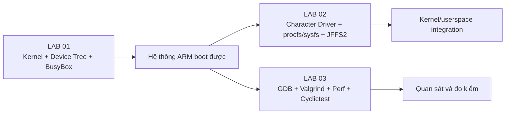
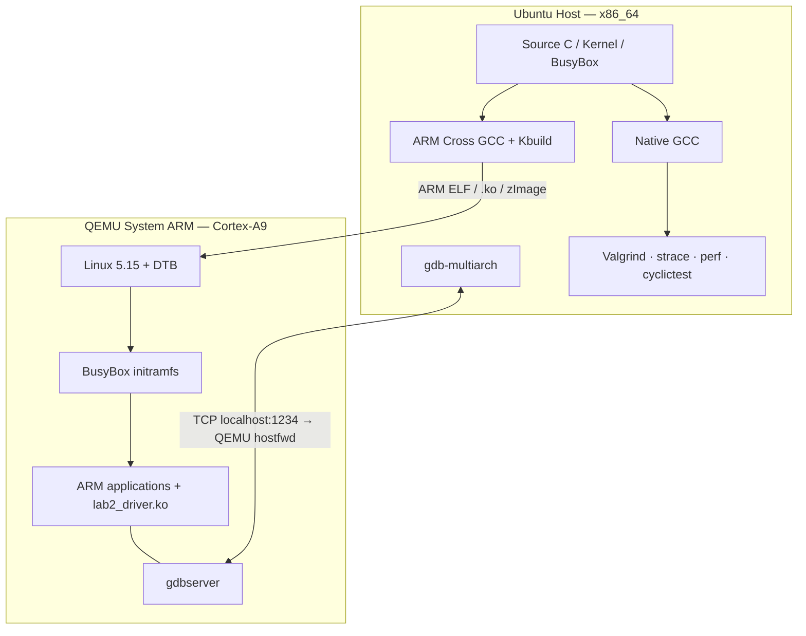

# LOS201 — Embedded Linux Systems

> **FPT University · ARMv7-A / Cortex-A9 · Linux 5.15 · QEMU Versatile Express · Ubuntu 24.04**
>
> Workspace thực hành từ cấu hình/khởi động Linux nhúng, lập trình kernel module, đến debug, profiling và phân tích độ trễ thời gian thực.

**Tài liệu:** [LAB 01](embedded_lab1/README.md) · [LAB 02](embedded_lab2/README.md) · [LAB 03](embedded_lab3/README.md)

## Mục lục

- [1. Giới thiệu](#1-giới-thiệu)
- [2. Môi trường thực nghiệm](#2-môi-trường-thực-nghiệm)
- [3. Kiến trúc Host–Target](#3-kiến-trúc-hosttarget)
- [4. Cấu trúc workspace](#4-cấu-trúc-workspace)
- [5. Chuẩn bị công cụ](#5-chuẩn-bị-công-cụ)
- [6. Quick start](#6-quick-start)
- [7. Kết quả chính của từng Lab](#7-kết-quả-chính-của-từng-lab)
- [8. Quy ước thực nghiệm và lưu kết quả](#8-quy-ước-thực-nghiệm-và-lưu-kết-quả)
- [9. Troubleshooting](#9-troubleshooting)
- [10. Nhóm thực hiện và tài liệu](#10-nhóm-thực-hiện-và-tài-liệu)

## 1. Giới thiệu

Workspace này phát triển một nền tảng **Embedded Linux ARMv7-A** chạy trên máy ảo QEMU `vexpress-a9`. Các phần thực hành kế thừa nhau:

| Bài | Chủ đề | Đầu ra chính | README |
|---|---|---|---|
| LAB 01 | Kernel configuration, U-Boot, BusyBox, initramfs, QEMU | `zImage`, `.dtb`, rootfs, initramfs boot được | [Chi tiết](embedded_lab1/README.md) |
| LAB 02 | Character device, `procfs`/`sysfs`, MTD/JFFS2, BusyBox init | `lab2_driver.ko`, `/dev/lab2`, NAND giả lập, initramfs auto-load | [Chi tiết](embedded_lab2/README.md) |
| LAB 03 | Remote GDB, Valgrind, `strace`/`perf`, `cyclictest` | ARM debugging, leak report, CPU hotspots, histogram latency | [Chi tiết](embedded_lab3/README.md) |

### Luồng học tập



**Phạm vi:** Các phép thử là kết quả trong QEMU ARM hoặc trên Ubuntu Host, **không phải** benchmark hiệu năng phần cứng ARM vật lý. Các nội dung PREEMPT_RT ở LAB 03 hiện là đối chiếu lý thuyết, chưa có phép đo RT kernel thực tế.

## 2. Môi trường thực nghiệm

| Thành phần | Phiên bản / cấu hình |
|---|---|
| Host | Ubuntu 24.04 LTS (Noble), x86_64 |
| Host kernel (phiên thí nghiệm) | `6.8.0-147-generic`, PREEMPT_DYNAMIC |
| Target | ARMv7-A / Cortex-A9, QEMU `vexpress-a9` |
| Target kernel | Linux `5.15.0` |
| Cấu hình QEMU thường dùng | RAM 512 MiB, 2 vCPU, serial `ttyAMA0` |
| Toolchain | `arm-linux-gnueabihf-` (ARM hard-float ABI) |
| Userspace | BusyBox 1.35.0, initramfs (`cpio` + `gzip`) |
| Bootloader LAB 01 | U-Boot 2022.04 |
| Ngôn ngữ chính | C, Shell, Gnuplot |
| Công cụ LAB 03 | `gdb-multiarch`, `gdbserver`, `valgrind`, `strace`, `perf`, `cyclictest`, `stress-ng` |

Các lệnh trong README giả định terminal Bash trên Ubuntu. **Đường dẫn thực tế có thể khác** giữa các lần thực hành; dùng `pwd`, `ls`, `find` để xác minh trước khi chạy.

## 3. Kiến trúc Host–Target



**Ba dấu nhắc không được nhầm:**

```text
HOST   $       cd, gcc, make, qemu-system-arm, perf, valgrind
QEMU   / #     uname, insmod, cat /proc/..., gdbserver
GDB    (gdb)   target remote, break, continue, backtrace
```

**Lab 2 MTD/JFFS2** và **Lab 3 cyclictest** chạy trên Host. Character driver và ARM remote debugging chạy trong QEMU. Valgrind/Perf chính được đo trên bản ứng dụng biên dịch cho Host.

## 4. Cấu trúc workspace

Đường dẫn dự kiến của project m:

```text
~/LOS201/
├── README.md                         # Tài liệu tổng quan (file này)
├── embedded_lab1/
│   ├── README.md
│   ├── configs/                      # kernel.config, busybox.config (nếu đã lưu)
│   ├── output/                       # zImage, DTB, initramfs.cpio.gz
│   └── rootfs/initramfs/             # BusyBox root filesystem
├── embedded_lab2/
│   ├── README.md
│   ├── driver/                       # lab2_driver.c, Makefile, .ko
│   ├── rootfs/initramfs/             # rcS, module, test scripts
│   ├── output/                       # initramfs_lab2.cpio.gz
│   └── logs/                         # driver, MTD/JFFS2, test evidence
└── embedded_lab3/
    ├── README.md
    ├── apps/                         # buggy_app*, leaky_app*, perf_target*
    ├── rootfs/                       # ARM userspace variants
    ├── output/                       # initramfs_lab3*.cpio.gz
    └── logs/                         # GDB, Valgrind, perf, hist, PNG
```

> **Lưu ý đường dẫn:** Trong một số lệnh LAB 03 đã kiểm chứng, kernel LAB 01 được lấy từ `~/embedded_lab1/output/` (ngoài `~/LOS201/`). Hai vị trí này **không mặc nhiên giống nhau**. Kiểm tra trước khi boot:
>
> ```bash
> ls -l ~/embedded_lab1/output/zImage ~/LOS201/embedded_lab1/output/zImage 2>/dev/null
> ```
>
> README mô tả cấu trúc và các file thường gặp, không khẳng định tất cả file đều có trong bản clone của người đọc.

## 5. Chuẩn bị công cụ

### 5.1. Cài trên Ubuntu Host

```bash
sudo apt update
sudo apt install -y \
  build-essential git make bc bison flex cpio gzip file rsync \
  libncurses-dev libssl-dev libelf-dev \
  gcc-arm-linux-gnueabihf binutils-arm-linux-gnueabihf \
  qemu-system-arm u-boot-tools gdb-multiarch \
  valgrind strace linux-tools-common linux-tools-generic \
  rt-tests stress-ng gnuplot mtd-utils
```

Một số phiên bản Ubuntu đặt công cụ `perf` trong gói theo phiên bản kernel; kiểm tra `perf version`. Nếu thiếu, cài gói `linux-tools-$(uname -r)` phù hợp kho phân phối. Với JFFS2, module `nandsim`/`mtdblock` phụ thuộc cấu hình kernel Host.

### 5.2. Kiểm tra công cụ

```bash
uname -a
qemu-system-arm --version | head -1
arm-linux-gnueabihf-gcc --version | head -1
gdb-multiarch --version | head -1
perf version
cyclictest --version
command -v mkfs.jffs2
```

### 5.3. Biến môi trường gợi ý

```bash
export LOS201_HOME="$HOME/LOS201"
export ARCH=arm
export CROSS_COMPILE=arm-linux-gnueabihf-

# Cấu hình theo thư mục source Kernel 5.15 THỰC TẾ trên máy:
# export KERNEL_SRC="$HOME/linux-5.15"
```

Không biên dịch kernel module với header của kernel Host 6.8; `.ko` ARM phải build với **kernel source/config tương thích target Linux 5.15**.

## 6. Quick start

### LAB 01 — Boot hệ thống Linux cơ bản

```bash
cd ~/LOS201/embedded_lab1
ls -lh output/zImage output/vexpress-v2p-ca9.dtb output/initramfs.cpio.gz

qemu-system-arm -M vexpress-a9 -cpu cortex-a9 -m 512M -smp 2 \
  -kernel output/zImage \
  -dtb output/vexpress-v2p-ca9.dtb \
  -initrd output/initramfs.cpio.gz \
  -append 'console=ttyAMA0,115200 rdinit=/sbin/init mem=512M' \
  -nographic -no-reboot
```

Trong QEMU (`/ #`):

```sh
uname -a
cat /proc/cpuinfo
ps
mount
cat /proc/cmdline
```

Để thoát QEMU `-nographic`: **Ctrl+A**, thả ra rồi nhấn **X**.

### LAB 02 — Boot hệ thống có character driver

```bash
cd ~/LOS201/embedded_lab2
ls -lh output/initramfs_lab2.cpio.gz
# Xem lệnh boot và cách xác định kernel LAB 01 tại embedded_lab2/README.md.
```

Trong QEMU, kiểm tra `/dev/lab2`, `/proc/lab2_info`, các sysfs attributes và chạy hai test script. Thí nghiệm flash NAND/JFFS2 **thực hiện riêng trên Host**, không chạy trên NAND vật lý.

### LAB 03 — Debug, memory, CPU và latency

```bash
cd ~/LOS201/embedded_lab3
ls apps/buggy_app_original.c apps/leaky_app.c apps/perf_target_profile.c
ls logs/valgrind_report.txt logs/perf_profile_report.txt logs/hist_standard.txt
```

- ARM/GDB: xem [LAB 03 — Part A](embedded_lab3/README.md#4-part-a--remote-debugging-arm)
- Valgrind/VmRSS: [LAB 03 — Part B](embedded_lab3/README.md#5-part-b--memory-analysis)
- `strace` / `perf`: [LAB 03 — Part C](embedded_lab3/README.md#6-part-c--performance-profiling)
- `cyclictest`: [LAB 03 — Part D](embedded_lab3/README.md#7-part-d--real-time-latency)

## 7. Kết quả chính của từng Lab

| Lab | Kết quả xác thực | Giới hạn |
|---|---|---|
| 01 | Boot Linux 5.15 ARMv7 vào BusyBox; PID 1 là `init`; `proc`, `sysfs`, `tmpfs` mount thành công; U-Boot 2022.04 đã thử nghiệm | Lệnh boot U-Boot và địa chỉ nạp phụ thuộc cấu hình/memory map |
| 02 | ARM `lab2_driver.ko`, major 240; `/dev/lab2` read/write; procfs/sysfs; NAND giả lập 16 MiB và JFFS2 remount vẫn giữ dữ liệu | Không phải kiểm thử chịu tải concurrent toàn diện; NAND nằm trong RAM Host |
| 03 | GDB bắt ba lỗi; Valgrind 16.900 → 0 bytes leaked; perf 4.446 samples; max latency baseline 50 µs và stress 299 µs | Không có benchmark trên ARM thật và chưa thử nghiệm PREEMPT_RT |

Các con số là **dữ liệu của phiên đo đã lưu**, không phải chuẩn đầu ra cố định mà máy khác phải đạt.

## 8. Quy ước thực nghiệm và lưu kết quả

- **Không chỉnh số cho đẹp.** Mỗi nhận xét phải truy về source, cấu hình, log hoặc ảnh tương ứng.
- Tách bản source cố ý có lỗi (`*_original.c`, `leaky_app.c`) khỏi bản đã sửa (`*_fixed.c`).
- Ghi rõ **Host** hay **QEMU Guest**, kiến trúc, loại kernel, đơn vị và thông số workload.
- `output/` chứa hiện vật boot/build; `logs/` chứa raw log và ảnh; báo cáo Word/PDF không thay thế source/log.
- `perf record` dùng samples thống kê, tỷ lệ overhead không phải phần trăm thời gian tuyệt đối.
- `cyclictest` phản ánh wake-up latency của scheduler, **không** đo deadline end-to-end của robot.
- Không commit mật khẩu, SSH key, rootfs có thông tin riêng tư hoặc dump kernel chứa dữ liệu nhạy cảm.

Gợi ý kiểm tra trước khi nộp:

```bash
cd ~/LOS201
find embedded_lab1/output embedded_lab2/output embedded_lab3/output -maxdepth 1 -type f -printf '%p\n' 2>/dev/null
find embedded_lab3/logs -maxdepth 1 -type f | sort
find . -type f \( -name '*.md' -o -name '*.c' -o -name '*.sh' \) | sort | head -80
```

## 9. Troubleshooting

| Hiện tượng | Cách kiểm tra / hướng xử lý |
|---|---|
| QEMU không tìm thấy `zImage`/DTB | Kiểm tra thư mục hiện tại với `pwd`, `ls`; dùng đường dẫn tuyệt đối đã xác minh. |
| Boot xong không có shell | Xem `console=ttyAMA0`, `rdinit=/sbin/init`, BusyBox static, `inittab`, `rcS`, archive `cpio`. |
| Lệnh ARM ELF chạy trên Host báo lỗi format | Chạy trong QEMU ARM hoặc với ARM emulator thích hợp, không chạy trực tiếp trên x86. |
| `insmod` báo `invalid module format` | Xem `modinfo -F vermagic`, `uname -r` trên Guest và `.config` kernel. |
| Không thấy `/dev/lab2` | Xem `lsmod`, `/proc/devices`, `dmesg` và `rcS` của Lab 2. |
| `gdbserver` không kết nối được | Kiểm tra IP Guest, TCP port 1234, port forwarding; `target remote 127.0.0.1:1234` dùng trên Host. |
| Perf báo `perf_event_paranoid=4` | Thử `sudo perf record`; **không** tự hạ quyền bảo mật nếu chưa cần. |
| `perf report` từ chối chủ sở hữu file | Chỉ với `.data` tự tạo và đã kiểm tra: dùng `perf report -f`. |
| Histogram khác máy khác | Kiểm tra kernel, stress workload, giới hạn `-h`, số mẫu và overflow; không sao chép kết quả máy khác. |

## 10. Nhóm thực hiện và tài liệu

**Nhóm LAB 02–03:**

| Thành viên | MSSV |
|---|---|
| Lê Tiến Thành | SE201799 |
| Lê Tấn Lộc | SE201412 |
| Trần Trương Tuấn Vũ | SE196467 |

> Hồ sơ LAB 01 còn ghi nhận thành viên **Trần Đình Khôi Nguyên — SE200558** trong nhóm 5 người. Danh sách từng Lab có thể khác nhau; xem trang bìa báo cáo tương ứng.

**Nguồn đối chiếu:** Đề LAB01/LAB02/LAB03 Embedded Linux Systems, báo cáo và log thực nghiệm của nhóm; cấu trúc README được tham khảo từ [embedded-linux-kernel-development (myNameDyK)](https://github.com/myNameDyK/embedded-linux-kernel-development) nhưng **các lệnh, môi trường và số liệu ở đây được viết theo workspace LOS201**, không lấy benchmark của repo tham khảo.

**Đọc thêm:** [Linux kernel](https://www.kernel.org/doc/html/latest/) · [QEMU](https://www.qemu.org/docs/master/) · [BusyBox](https://busybox.net/) · [U-Boot](https://docs.u-boot.org/) · [Valgrind](https://valgrind.org/docs/manual/) · [Linux perf security](https://www.kernel.org/doc/html/latest/admin-guide/perf-security.html).
