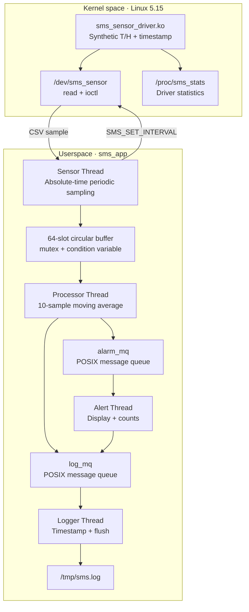
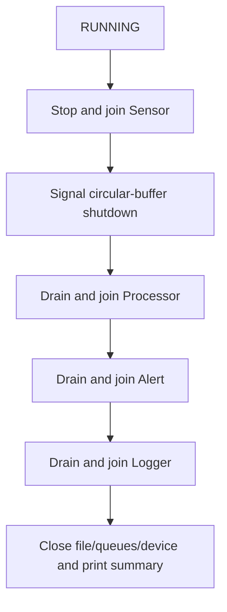

# Assignment 02 — Sensor Monitoring System (SMS)

**LOS201 · Embedded Linux Systems · FPT University**  
**C / Linux 5.15 / ARMv7 Cortex-A9 / QEMU vexpress-a9 / POSIX Threads / POSIX Message Queues**

> A multithreaded temperature-and-humidity monitoring application connected to a simulated Linux kernel sensor driver. This README documents the **team's implementation and observed tests**, rather than a generic reference project.

## 1. Overview

The Sensor Monitoring System (SMS) integrates an ARM Linux kernel module with a userspace application consisting of **four POSIX worker threads**. The driver generates synthetic temperature and humidity readings, exposes them as comma-separated records through a character device, accepts a sampling-interval configuration through `ioctl()`, and publishes operational statistics through procfs.

The application reads the sensor periodically, buffers samples, computes rolling averages, detects abnormal values, displays alerts, writes a timestamped log, and reports scheduling jitter and final statistics. Both **SCHED_OTHER** and **SCHED_FIFO** sensor-thread scheduling are supported for comparative experiments.

The sensor is **simulated**, not connected to real medical or industrial hardware. Reported values and alert frequencies must not be interpreted as physical measurements.

### Team

| Member | Student ID |
|---|---|
| Lê Tiến Thành | SE201799 |
| Lê Tấn Lộc | SE201412 |
| Trần Đình Khôi Nguyên | SE200558 |
| Trần Trương Tuấn Vũ | SE196467 |

**Lecturer:** Phạm Thế Vinh  
**Course:** Embedded Linux Systems (LOS201)  
**Academic work:** October 2026

## 2. Features and requirements

| Component | Implemented behavior |
|---|---|
| Linux kernel module | `sms_sensor_driver.ko`, `miscdevice` registration, simulated readings |
| Sensor device | `/dev/sms_sensor`; one CSV record per successful read |
| Driver configuration | `SMS_SET_INTERVAL` ioctl; valid interval **1–60000 ms** |
| Statistics | `/proc/sms_stats`: reads, latest temperature/humidity, uptime, interval |
| Sensor thread | Periodic reads with `clock_nanosleep(CLOCK_MONOTONIC, TIMER_ABSTIME, ...)` |
| Circular buffer | Preallocated **64-slot** queue with mutex, condition variable and overflow counter |
| Processor thread | Rolling average of the latest **10** temperature/humidity samples |
| Alert thread | Handles `TEMP_HIGH`, `HUMID_HIGH`, `TEMP_SPIKE` |
| Logger thread | Sole writer of `/tmp/sms.log`, with flushing and a 1 MiB rotation path |
| Thread communication | A bounded circular buffer, `alarm_mq`, and `log_mq` |
| Scheduling | `SCHED_OTHER` or attempted `SCHED_FIFO` at priority 50 |
| Exit | Duration limit or SIGINT/SIGTERM; ordered thread shutdown and final summary |
| Instrumentation | Valgrind, GDB, strace, perf, `/proc/PID/status`, jitter histogram |

**Important distinction:** Log rotation at 1 MiB is present in the implementation but was **not stress-tested with a file larger than 1 MiB** in the reported experiments. Likewise, successful activation of `SCHED_FIFO` must be verified from the application's actual report, not inferred solely from `-s 1`.

## 3. Development environment

| Item | Configuration used |
|---|---|
| Host | Ubuntu 24.04, x86_64 |
| Target | ARMv7-A / Cortex-A9 |
| Emulator | QEMU `vexpress-a9`, 512 MiB RAM, 2 vCPUs |
| Target Linux | 5.15.0 |
| C toolchain | `arm-linux-gnueabihf-gcc` |
| Kernel source | `~/embedded_lab1/kernel/linux-5.15` |
| Device Tree | `~/embedded_lab1/output/vexpress-v2p-ca9.dtb` |
| Root filesystem | BusyBox-based initramfs with ARM application and `.ko` |
| Essential kernel options | `CONFIG_POSIX_MQUEUE=y`, `CONFIG_HIGH_RES_TIMERS=y` |
| Host tools | `gcc`, `make`, `qemu-system-arm`, `cpio`, `gzip`, `gdb`, `valgrind`, `strace`, `perf` |

The x86_64 and ARM runs serve different purposes. **The ARM/QEMU run validates device-driver integration**, whereas Valgrind, strace, perf and most source-level debugging experiments were performed against the **host binary with a mock sensor file**.

> **Do not build the ARM driver against the Ubuntu host's `/lib/modules/$(uname -r)/build`.** Use the same ARM Linux 5.15 build tree and configuration as the QEMU kernel to avoid `vermagic` or ABI mismatches.

## 4. Project structure

The principal files are organized as follows. Compiled outputs and log filenames may depend on the individual build or test run.

```text
embedded-linux-assignment02/
├── README.md
├── app/
│   ├── Makefile
│   ├── sms_app.c                  # CLI, initialization, signals, joins, summary
│   ├── app_config.h               # Shared context and configuration
│   ├── sensor_thread.c            # Sensor read loop and jitter measurement
│   ├── sensor_thread.h
│   ├── processor_thread.c         # Rolling averages and alarm decisions
│   ├── processor_thread.h
│   ├── alert_thread.c             # Alert consumer and counters
│   ├── alert_thread.h
│   ├── logger_thread.c            # Log consumer, flush and rotation
│   ├── logger_thread.h
│   ├── circular_buffer.c          # Bounded ring buffer / synchronization
│   ├── circular_buffer.h
│   ├── sms_app                    # Cross-compiled ARM executable, after build
│   └── sms_app_x86                # Host executable, after build
├── driver/
│   ├── Makefile
│   ├── sms_sensor_driver.c
│   ├── sms_sensor.h               # SMS_SET_INTERVAL ioctl definition
│   └── sms_sensor_driver.ko       # ARM kernel module, after build
├── rootfs/                       # BusyBox rootfs and installation tree
├── output/                       # Generated kernel / initramfs images
├── logs/                         # Saved experimental logs, if present
└── report/ or bao_cao/           # Report/deliverables, where retained
```

The project was previously operated from:

```bash
cd /home/letienthanh/LOS201/embedded-linux-assignment02
```

Confirm the local tree before rebuilding:

```bash
find app driver output -maxdepth 2 -type f | sort
ls -lah rootfs/ logs/ 2>/dev/null
```

## 5. System architecture



The **four worker threads** are Sensor, Processor, Alert and Logger. The main thread handles argument parsing, initialization, signal observation, orderly shutdown and reporting.

### 5.1 End-to-end data path

1. **Sensor:** requests a sample through `read(/dev/sms_sensor)`, parses the CSV data, records wake-up jitter and pushes a `SensorData` record into the circular buffer.
2. **Processor:** pops samples, updates rolling averages, checks thresholds, sends alarms to `alarm_mq` and INFO messages to `log_mq`.
3. **Alert:** receives alarms, prints them to standard error, increments counters and forwards alert messages into `log_mq`.
4. **Logger:** consumes INFO and ALERT messages from `log_mq` and writes the timestamped records to `/tmp/sms.log`.
5. **Main:** stops the pipeline in producer-to-consumer order to allow pending data to drain.

### 5.2 Why each communication mechanism is used

- The **ring buffer** avoids per-sample heap allocation in the time-sensitive Sensor thread and offers O(1) insertion/removal.
- A **mutex plus condition variable** protects the buffer and wakes the Processor when new data arrive.
- **POSIX message queues** preserve message boundaries and decouple Processor, Alert and Logger work.
- `mq_timedsend()` and `mq_timedreceive()` use bounded timeouts, preventing indefinite waits when a downstream stage stops responding.
- The **Logger thread** isolates potentially blocking file I/O from sensor acquisition and processing.

## 6. Kernel driver

### 6.1 Device interface

The module registers a misc character device, with an observed node like:

```text
crw-rw-rw- ... 10, 125 ... /dev/sms_sensor
```

**Major 10** is the shared misc-device major. Minor **125** was observed in the reported QEMU run and may differ in another environment.

Each successful `read()` produces one CSV record:

```text
<timestamp_ms>,<temperature_C>,<humidity_percent>\n
```

For example:

```text
93917,42.7,85.4
```

The simulator generates one-decimal values in these ranges:

| Field | Generator | Range |
|---|---|---|
| Temperature | `(150 + random % 301) / 10` | 15.0–45.0 °C |
| Humidity | `(300 + random % 601) / 10` | 30.0–90.0 % |
| Timestamp | `ktime_to_ms(ktime_get())` | Monotonic milliseconds |

The driver operates on integers (tenths) rather than using floating-point arithmetic in kernel space. A mutex protects state updates.

### 6.2 Interval ioctl

The shared header defines the control command equivalent to:

```c
#define SMS_SET_INTERVAL _IOW('x', 1, __u32)
```

The accepted interval is **1 to 60,000 milliseconds**, with **100 ms** as the driver default. The application sets it from `-i` during initialization. An invalid value is rejected with `-EINVAL`.

If two successful reads are requested closer together than the configured minimum interval, the driver may return `-EAGAIN`. The userspace Sensor thread retries transient read failures within a bounded per-period budget.

### 6.3 Procfs statistics

```sh
cat /proc/sms_stats
```

Typical structure:

```text
read_count: 20
last_temperature: 16.7 C
last_humidity: 37.5 %
uptime: 10 seconds
min_interval_ms: 500
```

`read_count` counts successful sample deliveries, **not** simply scheduled wake-ups. A difference between expected periods and `read_count` can therefore correspond to unsuccessful or skipped reads; the exact error type must be established separately.

## 7. Application command-line interface

Run inside the ARM guest after loading the module, or run the host binary with a mock path (`-p`).

| Option | Meaning | Default |
|---|---|---|
| `-i <ms>` | Sampling period in milliseconds | `500` |
| `-t <degC>` | High-temperature alert threshold | `40.0` |
| `-h <percent>` | High-humidity alert threshold | `80.0` |
| `-d <seconds>` | Run duration; `0` means no fixed duration | `60` |
| `-v` | Print each sensor sample | Disabled |
| `-s 0` | Sensor uses `SCHED_OTHER` | Default |
| `-s 1` | Request `SCHED_FIFO` for the Sensor thread | Off by default |
| `-p <path>` | Override device path (e.g., host mock file) | `/dev/sms_sensor` |
| `-l <path>` | Override log file path | `/tmp/sms.log` |

Examples:

```sh
/sms_app -i 500 -d 10 -s 0 -v
/sms_app -i 500 -d 60 -s 1
/sms_app -i 50 -d 55 -s 0
/sms_app -i 50 -d 55 -s 1
```

### 7.1 Alert rules

| Alert | Condition (defaults) | Example |
|---|---|---|
| `TEMP_HIGH` | Current temperature **> 40.0 °C** | 42.3 °C |
| `HUMID_HIGH` | Current humidity **> 80.0%** | 85.4% |
| `TEMP_SPIKE` | `abs(current_temp - previous_temp) > 5.0 °C` | 22.0 → 33.8 °C |

**TEMP_SPIKE compares consecutive readings, not the moving average.** The first sample cannot trigger a spike by comparison with a predecessor because none exists.

The unusually high `TEMP_SPIKE` rate is expected for a generator that chooses largely independent random temperatures over a 30 °C range; it is **not evidence of a failing physical sensor**.

### 7.2 Scheduling and jitter

The Sensor thread uses `CLOCK_MONOTONIC` and absolute target times with `TIMER_ABSTIME`; this helps avoid cumulative drift. With `-s 1`, it attempts `SCHED_FIFO` priority **50**. Real-time scheduling may require elevated permission or an appropriate `RLIMIT_RTPRIO` configuration. If scheduling fails, the application should report the actual scheduling policy; it must not be labeled FIFO based only on the CLI flag.

The jitter report includes **Min / Avg / Max / P99** in microseconds and four histogram bins:

```text
0-100us
100-500us
500-1000us
>1000us
```

These are **guest/QEMU scheduling observations**, not guaranteed latency bounds for a physical ARM board or a PREEMPT_RT kernel.

## 8. Build instructions (Ubuntu host)

### 8.1 Check prerequisites

```bash
cd /home/letienthanh/LOS201/embedded-linux-assignment02 || exit 1

command -v arm-linux-gnueabihf-gcc
command -v qemu-system-arm
command -v cpio

KDIR="$HOME/embedded_lab1/kernel/linux-5.15"
test -f "$KDIR/Makefile" || echo 'Missing ARM Linux 5.15 kernel tree'
```

### 8.2 Cross-compile the ARM kernel module

```bash
cd /home/letienthanh/LOS201/embedded-linux-assignment02/driver || exit 1

KDIR="$HOME/embedded_lab1/kernel/linux-5.15"

make -C "$KDIR" M="$PWD" \
  ARCH=arm CROSS_COMPILE=arm-linux-gnueabihf- modules

file sms_sensor_driver.ko
modinfo sms_sensor_driver.ko | grep vermagic
```

Expected: an **ARM 32-bit relocatable module** with a vermagic compatible with the target's Linux **5.15.0** and build configuration. Loading a module from an unrelated Linux host kernel is not a valid substitute.

### 8.3 Build the ARM and host applications

```bash
cd /home/letienthanh/LOS201/embedded-linux-assignment02/app || exit 1

make arm
file sms_app

make host
file sms_app_x86

# The source Makefile also provides a debug build target:
make debug
```

The ARM build was configured for a **statically linked executable**. A host binary is not runnable inside QEMU ARM, and the ARM executable is not directly runnable on the x86_64 host.

### 8.4 Assemble a test initramfs

The existing `rootfs/` tree was used to build a separate test image, so the source root filesystem was preserved. The example below assumes `rootfs/` itself is the root of the Guest filesystem and already contains a working BusyBox `/sbin/init` setup. Check with `ls -l rootfs/sbin/init` before using it.

```bash
cd /home/letienthanh/LOS201/embedded-linux-assignment02 || exit 1

WORK="$(mktemp -d)" || exit 1
mkdir -p "$WORK/root" output
cp -a rootfs/. "$WORK/root/"

install -m 755 app/sms_app "$WORK/root/sms_app"
install -m 644 driver/sms_sensor_driver.ko "$WORK/root/sms_sensor_driver.ko"
mkdir -p "$WORK/root/dev/mqueue" "$WORK/root/tmp"

(
  cd "$WORK/root" || exit 1
  find . -print0 | cpio --null -o -H newc 2>/dev/null | gzip -9
) > output/initramfs_asgn2_mqueue.cpio.gz

ls -lh output/initramfs_asgn2_mqueue.cpio.gz
rm -rf -- "$WORK"
```

This recipe repackages the **current** source rootfs; it does not install BusyBox or repair a missing `/sbin/init`. If your local layout has an `initramfs/` subdirectory, point the copy step at the actual root of the filesystem instead.

### 8.5 POSIX message queue requirement

The project originally failed with application **exit code 1** because the earlier target kernel did not expose the POSIX message queue filesystem. Observed symptoms included:

```text
mount -t mqueue mqueue /dev/mqueue
mount: ... failed: No such device
```

A later working target kernel showed:

```text
nodev   mqueue
mqueue on /dev/mqueue type mqueue (rw,relatime)
```

Check the *ARM kernel* build configuration:

```bash
KDIR="$HOME/embedded_lab1/kernel/linux-5.15"
grep -E '^CONFIG_(POSIX_MQUEUE|HIGH_RES_TIMERS)=' "$KDIR/.config"
```

Both should be `y`. If `CONFIG_POSIX_MQUEUE` was disabled, reconfigure and rebuild the **ARM kernel** and then boot the rebuilt `zImage`. Merely creating `/dev/mqueue` in the rootfs cannot add the missing filesystem to a kernel.

**Kernel-image warning:** The original Lab 1 `zImage` and a later mqueue-enabled `zImage` are **not interchangeable unless their configurations are compatible**. Prefer the matching kernel known to have successfully mounted `mqueue` and loaded the rebuilt driver.

## 9. Boot and test on QEMU ARMv7

### 9.1 Boot the mqueue-enabled image (Ubuntu host)

The following command uses the *named test artifacts* generated during the mqueue-fix work. If your local successful build has different filenames, first replace the two `output/` paths with those exact tested artifacts.

```bash
cd /home/letienthanh/LOS201/embedded-linux-assignment02 || exit 1

KERNEL_IMAGE="output/zImage_asgn2_mqueue"
INITRAMFS_IMAGE="output/initramfs_asgn2_mqueue.cpio.gz"
DTB_IMAGE="$HOME/embedded_lab1/output/vexpress-v2p-ca9.dtb"

for f in "$KERNEL_IMAGE" "$INITRAMFS_IMAGE" "$DTB_IMAGE"; do
  test -f "$f" || { echo "Missing: $f"; exit 1; }
done

qemu-system-arm \
  -M vexpress-a9 -cpu cortex-a9 -m 512M -smp 2 \
  -kernel "$KERNEL_IMAGE" -dtb "$DTB_IMAGE" \
  -initrd "$INITRAMFS_IMAGE" \
  -append 'console=ttyAMA0,115200 rdinit=/sbin/init' \
  -nographic -no-reboot
```

**Host terminal** has a prompt resembling `user@ubuntu:~$`. After boot, the **ARM guest** has a prompt resembling `/ #`. Commands referring to `/sms_app`, `/dev/sms_sensor`, `/proc/sms_stats`, and `/dev/mqueue` belong inside the Guest.

### 9.2 Validate kernel, queues and driver (QEMU guest)

```sh
uname -m
uname -r

grep mqueue /proc/filesystems
mount | grep mqueue

# If supported but not mounted:
mkdir -p /dev/mqueue
mount | grep -q ' /dev/mqueue ' || mount -t mqueue mqueue /dev/mqueue

# Load only if not already present:
grep -q '^sms_sensor_driver ' /proc/modules || insmod /sms_sensor_driver.ko

ls -l /dev/sms_sensor
cat /proc/sms_stats
dmesg | grep -i sms_sensor | tail -20
```

**Expected:** `armv7l`, Linux `5.15.0`, `/dev/sms_sensor` present, procfs statistics readable and `mqueue` available. The module observed previously registered a misc device at **10:125**, though its minor is dynamic.

### 9.3 Run a short functional test (QEMU guest)

```sh
echo '===== BEFORE ====='
cat /proc/sms_stats

/sms_app -i 500 -d 10 -s 0 -v
APP_RC=$?
echo "APP_EXIT_CODE=$APP_RC"

echo '===== AFTER ====='
cat /proc/sms_stats

echo '===== LOGGER ====='
ls -lh /tmp/sms.log
tail -15 /tmp/sms.log
```

Look for:

- `Sample: TS=... T=...(Avg=...) H=...(Avg=...)` lines;
- appropriately triggered `TEMP_HIGH`, `HUMID_HIGH`, and `TEMP_SPIKE` alarms;
- `Total Produced`, `Total Consumed`, `Overflows`, `Dropped`;
- `JITTER REPORT (SCHED_OTHER)` and histogram;
- application return code `0` and a nonempty log.

The Producer and Consumer counts should balance after an orderly shutdown, while driver `read_count` should increase with successful reads. **Do not require every scheduled wake-up to yield a sample**: the implementation counts skipped periods in `Dropped`.

### 9.4 A 60-second integration test (QEMU guest)

```sh
cat /proc/sms_stats
/sms_app -i 500 -d 60 -s 1
RC=$?
echo "APP_EXIT_CODE=$RC"
cat /proc/sms_stats
```

At a 500 ms interval, **60 seconds correspond to 120 scheduled periods**, not necessarily 120 successful driver reads. Confirm the *reported actual scheduling policy*; if `SCHED_FIFO` fails to activate, do not label this run FIFO.

### 9.5 Shutdown and SIGINT

Duration-based completion (`-d 10`, `-d 60`) was verified inside QEMU. The report describes an additional successful **SIGINT** shutdown test on the x86_64 build, but **a full interactive Ctrl+C shutdown on QEMU had not been independently verified in the report**. Test it before recording the final demonstration:

```sh
/sms_app -i 500 -d 0 -s 0 -v
# After some samples, press Ctrl+C in the QEMU console.
```

Check that the threads terminate and print their final summary. If terminal control prevents Ctrl+C from reaching the foreground process, check the BusyBox init/controlling-TTY setup; do not claim the SIGINT demo succeeded before observing it.

## 10. Verified experimental results

These are **historical measured results**, not promises that every new run will have the same values. Temperature and humidity are randomized, so alert totals will vary.

### 10.1 Successful 10-second QEMU test

A successful short run after the POSIX message queue fix produced:

| Item | Observed value |
|---|---:|
| Sampling interval | 500 ms |
| Duration | 10 seconds |
| Scheduling | SCHED_OTHER |
| Total Produced | 19 |
| Total Consumed | 19 |
| Overflows | 0 |
| Dropped | 0 |
| TEMP_HIGH | 2 |
| HUMID_HIGH | 2 |
| TEMP_SPIKE | 14 |
| Jitter Min / Avg / Max | 195 / 401 / 740 µs |
| Jitter P99 | 740 µs |
| Exit code | 0 |
| Driver `read_count` | 20 → 39 |
| `/tmp/sms.log` | Present; ~5.5 KiB after accumulated runs |

An earlier 10-second run also exited with code `0`, generated **20/20 produced/consumed**, **zero overflows/drops**, and wrote a log. These values illustrate normal variability between runs.

### 10.2 Reported 60-second ARM integration test

| Metric | Before | After |
|---|---:|---:|
| Driver `read_count` | 0 | 118 |
| `min_interval_ms` | 100 | 500 |
| Produced | — | 118 |
| Dropped periods | — | 2 |
| Buffer overflows | — | 0 |
| Jitter measurements | — | 120 |

The application ran for 60 seconds and reached its final summary. **Two skipped samples out of 120 periods** should be documented, not silently described as 120 successful samples.

### 10.3 Scheduling comparison under load

For three pairs of 55-second, 50-ms-interval measurements with **two CPU busy loops** in the QEMU guest, the historical median jitter values were:

| Metric (µs) | SCHED_OTHER | SCHED_FIFO 50 |
|---|---:|---:|
| Min | 171 | 107 |
| Avg | 296 | 198 |
| Max | 1848 | 731 |
| P99 | 575 | 336 |

The median P99 improved by approximately **41.6%** under those specific conditions. Without background load, the comparison was **mixed**; the experiment does not prove that FIFO is universally faster. QEMU timer and host scheduling effects limit generalization to real ARM hardware.

### 10.4 Memory analysis and profiling

| Tool | Historical observation | Interpretation |
|---|---|---|
| Valgrind, host mock sensor | 0 errors; all allocated blocks freed in two recorded runs | No leak observed along the tested mock-file path |
| ARM `/proc/PID/status` | VmSize 34,560 kB; VmRSS 33,412 kB at 5/30/55 s | No growth at those observation points |
| `strace -f -c`, host mock | 1,500 `mq_timedsend` calls in a 300-sample experiment | Matches the observed messaging path |
| perf, host mock | 725 samples in a historical 20-second run | Profiling primarily observed wait/syscall overhead |

These do **not** establish leak freedom for every driver path, memory-access correctness on all inputs or a hard real-time response guarantee.

## 11. Host-based debugging and instrumentation

The kernel driver is not available on Ubuntu x86_64, so the host application can read a synthetic CSV file using `-p`.

### 11.1 Build and create a mock sensor

```bash
cd /home/letienthanh/LOS201/embedded-linux-assignment02/app || exit 1
make host
printf '1500,42.3,85.2\n' > sms_mock_sensor
```

### 11.2 Valgrind

```bash
mkdir -p ../logs
valgrind --leak-check=full --show-leak-kinds=all --track-fds=yes \
  ./sms_app_x86 -p sms_mock_sensor -i 200 -d 60 \
  > ../logs/valgrind_app_stdout.txt \
  2> ../logs/valgrind_sms.txt

grep -E 'definitely lost:|ERROR SUMMARY:|All heap blocks were freed' \
  ../logs/valgrind_sms.txt
```

The one-line mock data exercise high-temperature and high-humidity alerts, **but not TEMP_SPIKE**, since successive temperatures are identical.

### 11.3 strace

```bash
strace -f -c -o ../logs/strace_sms.txt \
  ./sms_app_x86 -p sms_mock_sensor -i 100 -d 30
cat ../logs/strace_sms.txt
```

`-f` follows all threads. Statistics are for **syscalls**, not a direct CPU-user/kernel-time percentage for the entire application.

### 11.4 perf

```bash
# Use a fresh log path writable by the benchmark's execution user.
perf record -F 999 -g -o ../logs/perf_sms.data -- \
  ./sms_app_x86 -p sms_mock_sensor \
  -l /tmp/sms_perf_log_$(id -u).txt -i 10 -d 20

perf report -i ../logs/perf_sms.data \
  --no-children --sort symbol --stdio \
  > ../logs/perf_sms_report.txt
```

If `perf_event_paranoid` blocks a non-root run, obtain appropriate privileges while **preserving consistent file permissions for the application**. An earlier run as root could not open a pre-existing user-owned `/tmp/sms.log`, which caused the Logger to stop and downstream backpressure to create buffer overflows. Use a unique output path instead of disabling operating-system protections.

### 11.5 GDB

```bash
make debug
# Verify the actual produced filename with: ls -l sms_app* 
# Example if the Makefile builds sms_app_x86_dbg:
gdb --args ./sms_app_x86_dbg -p sms_mock_sensor -i 500 -d 15
```

Break in `processor_thread.c`, inspect the thread list, local sample values and call stacks. **A prior GDB variable-modification experiment did not include observation of the expected subsequent TEMP_HIGH alert**, so that specific cause-and-effect claim remains an open verification item.

## 12. Concurrency and lifecycle

### 12.1 State and locking

The buffer's shared indices, count, shutdown state and overflow statistics are protected by a **mutex**. The condition-variable wait releases the mutex while waiting, and mutex-holding code does not make blocking queue sends. Separate atomic flags control thread shutdown; alerts and log messages are delivered through POSIX queues.

The implementation sets the buffer mutex to use `PTHREAD_PRIO_INHERIT` to mitigate priority inversion between a FIFO Sensor thread and normal-priority Processor. The benefit of this attribute was **not isolated in a dedicated measurement**.

### 12.2 Ordered shutdown



The order follows the data flow and prevents earlier stages from writing to a queue after its consumer has already exited. Time-limited queue operations also avoid indefinite waits if the downstream component fails.

### 12.3 Important bugs found during development

| Symptom | Root cause | Fix |
|---|---|---|
| Alert count remained zero; queues filled | `mq_timedreceive` supplied a receive buffer smaller than `mq_msgsize` (EMSGSIZE) | Receive buffer at least 256 bytes, with room for terminator |
| Potential races when stopping threads | One non-atomic global stop flag, and unsafe buffer-size reads | Atomic flags, locked buffer access and ordered joins |
| Wrong/incomplete string reads | Queue messages sent without NUL terminator | Send `strlen + 1`; bound and terminate receive buffer |
| Log messages out of order | Different POSIX queue priorities | Use consistent queue message priority |
| Early failure, exit 1, no sample | Older ARM kernel lacked `CONFIG_POSIX_MQUEUE` | Boot rebuilt mqueue-capable kernel and mount `/dev/mqueue` |
| High overflow under sudo perf | Logger failed to open protected pre-existing `/tmp/sms.log` | Use an accessible distinct log path and handle file errors |

## 13. Demo video — five required parts (3–5 minutes)

The course demo should show **real execution**, readable terminal output and explanation of the processing pipeline. A practical four-minute plan is:

| Segment | Target duration | Demonstration |
|---|---:|---|
| 1. Boot + driver | ~45 s | QEMU, `insmod`, `/dev/sms_sensor`, `/proc/sms_stats` |
| 2. Live samples | ~45 s | `sms_app -v` and periodic sensor output |
| 3. Alerts | ~60 s | Explain `TEMP_HIGH`, `HUMID_HIGH`, `TEMP_SPIKE` conditions |
| 4. Logger | ~30 s | Show `/tmp/sms.log` containing INFO/ALERT records |
| 5. Shutdown | ~45 s | Ctrl+C / SIGINT and final thread/buffer/alert/jitter summary |

**Before recording**, check that Ctrl+C actually reaches the foreground ARM application through the BusyBox/QEMU console and that the logger output is readable. If demonstrating a live-growing log from a single serial console, use a separate background run and compare `wc -l /tmp/sms.log` before/after a few seconds; return to a foreground run for the Ctrl+C demonstration. Do not assume a background job will respond to SIGINT in the same way as a foreground job.

The submission example filename is `SE201799_demo.mp4` (under `demo/` if that is the structure expected by the handout). Confirm final video duration and audio before submission.

## 14. Troubleshooting

| Problem | Check / action |
|---|---|
| `sms_app` immediately exits `1` | Check `mqueue` support/mount, device node, `mq_open`, driver `ioctl` and file errors; inspect source diagnostics |
| `mount -t mqueue ...` reports `No such device` | Running kernel lacks `CONFIG_POSIX_MQUEUE`; boot mqueue-enabled ARM `zImage` |
| `insmod` fails | Check `.ko` location, `uname -r`, `modinfo ... | grep vermagic`, `dmesg` |
| `/dev/sms_sensor` missing | Confirm module loaded and misc device registered; check `/proc/misc` |
| No log output | Check `/tmp` mount/permissions and `-l` path; verify Logger thread does not exit early |
| Produced lower than periods | Inspect driver `-EAGAIN`, transient read retries and `Dropped` count |
| `SCHED_FIFO` not active | Check scheduling permissions, application warning and actual `JITTER REPORT` policy |
| High jitter | Re-run under same load and interval; distinguish QEMU overhead from scheduler behavior |
| Ctrl+C does not stop app | Check foreground process group, serial controlling TTY and BusyBox initialization |
| `dmesg` reports warnings | Distinguish nonfatal emulated peripheral warnings from crashes/oops in the sensor driver |
| Host command entered at `/ #` | Host paths like `~/LOS201/...` do not exist inside the minimal ARM guest |
| Guest command entered at Ubuntu `$` | `/sms_app` and `/dev/sms_sensor` are in the initramfs; use the QEMU guest console |

## 15. Scope and limitations

The project demonstrates a functioning end-to-end sensor-monitoring pipeline on ARM QEMU, but the following points were **not fully closed by the recorded experiments**:

1. A GDB-modified sample producing a subsequently observed alert in the Alert thread.
2. Valgrind coverage of the actual ARM driver read path and the TEMP_SPIKE branch.
3. Error-code attribution for every missed sampling period.
4. A forced log-rotation test beyond 1 MiB.
5. Independent measurement of priority-inheritance impact.
6. Reliable long-run deadline guarantees on **physical** ARM hardware / PREEMPT_RT.
7. Complete cleanup if `pthread_create` fails partway through thread creation.
8. Explicit QEMU **Ctrl+C** shutdown evidence in the original report; duration-based QEMU shutdown and host SIGINT were verified.

These distinctions avoid equating a successful short functional run with complete functional, stress, safety or real-time certification.

## 16. Evidence and deliverables

Useful files from the experiments and report include the following, **when present in the project package**:

| Evidence | Purpose |
|---|---|
| `logs/qemu_run.txt` | ARM boot, driver integration, application output |
| `logs/proc_sms_stats_before.txt`, `logs/proc_sms_stats_after.txt` | Driver statistics across a test |
| `logs/sms_sample_run.txt` | Sample and alert terminal output |
| `logs/jitter_report.txt` | Scheduling comparisons / histograms |
| `logs/valgrind_sms.txt` | Host memory-analysis summary |
| `logs/strace_sms.txt` | Host system-call trace |
| `logs/perf_sms.txt` / `perf_sms_report.txt` | CPU profiling results |
| `/tmp/sms.log` (guest) | Timestamped INFO and ALERT log |
| `SE201799_Asgn02_Report_EN.docx` or PDF equivalent | Detailed report |
| `demo/SE201799_demo.mp4` | Recorded five-part demonstration, once created |

**Do not assume an entry is present just because it is documented here.** Confirm actual filenames before packaging, and include only files you generated or are permitted to redistribute.

## 17. References

- Embedded Linux Systems (LOS201), Assignment 02 handout.
- Christopher Hallinan, *Embedded Linux Primer*, 2nd edition.
- Jonathan Corbet, Alessandro Rubini and Greg Kroah-Hartman, *Linux Device Drivers*, 3rd edition.
- Michael Kerrisk, *The Linux Programming Interface*.
- Linux manual pages: `pthread_create(3)`, `mq_open(3)`, `mq_receive(3)`, `clock_nanosleep(2)`, `sched_setscheduler(2)`, `strace(1)`.
- Linux kernel documentation for POSIX message queues, scheduling, misc devices and procfs.

---

**Project status:** Driver and four-thread pipeline functionally verified on QEMU ARMv7; historical host memory/profiling tests and scheduling comparisons are documented with their limits. This is an educational prototype and is **not** a validated safety-critical monitoring system.
