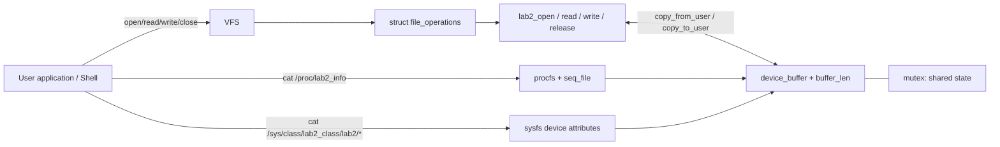

# LAB 02 — Character Device Driver, procfs/sysfs & MTD/JFFS2

**LOS201 · Linux Kernel Module · ARMv7 Cortex-A9 · QEMU `vexpress-a9` · BusyBox Init**

[← Workspace](../README.md) · [← LAB 01](../embedded_lab1/README.md) · [LAB 03 →](../embedded_lab3/README.md)

## Mục lục

- [1. Tổng quan và yêu cầu](#1-tổng-quan-và-yêu-cầu)
- [2. Môi trường và cấu trúc project](#2-môi-trường-và-cấu-trúc-project)
- [3. Kiến trúc Linux character driver](#3-kiến-trúc-linux-character-driver)
- [4. Part A — Build và kiểm thử device driver](#4-part-a--build-và-kiểm-thử-device-driver)
- [5. Part B — procfs và sysfs](#5-part-b--procfs-và-sysfs)
- [6. Part C — MTD / NAND giả lập / JFFS2](#6-part-c--mtd--nand-giả-lập--jffs2)
- [7. Part D — BusyBox init và auto-load](#7-part-d--busybox-init-và-auto-load)
- [8. Kết quả đo và phân tích](#8-kết-quả-đo-và-phân-tích)
- [9. Troubleshooting](#9-troubleshooting)
- [10. Kiểm tra bài nộp và tham khảo](#10-kiểm-tra-bài-nộp-và-tham-khảo)

## 1. Tổng quan và yêu cầu

LAB 02 kế thừa **Linux 5.15 + BusyBox initramfs** từ LAB 01, phát triển một **loadable kernel module (`.ko`)** cung cấp character device và trạng thái driver cho userspace. Phần MTD/JFFS2 được kiểm chứng **riêng trên Ubuntu Host** thông qua NAND giả lập `nandsim`.

Các đầu ra:

| Part | Mục tiêu | Bằng chứng chính |
|---|---|---|
| A | Character device với `open`, `read`, `write`, `release` | `lab2_driver.ko`, `/dev/lab2`, `test_driver.sh` PASS |
| B | Công bố trạng thái driver qua `/proc` và `/sys` | `/proc/lab2_info`, 3 sysfs attributes, `test_procfs.sh` PASS |
| C | Tạo và mount JFFS2 trên NAND MTD giả lập | `mtdinfo`, erase, `nandwrite`, remount, `nanddump` |
| D | Auto-load `.ko` khi BusyBox khởi động | `rcS`, boot log, `/dev/lab2` tồn tại sau boot |

**Không trộn hai kernel:** Driver được build cho **target ARM Linux 5.15**; JFFS2/nandsim chạy với **Host Ubuntu kernel 6.8**.

## 2. Môi trường và cấu trúc project

| Thành phần | Cấu hình |
|---|---|
| HOST | Ubuntu 24.04 x86_64, kernel phiên kiểm thử `6.8.0-147-generic` |
| TARGET | QEMU `vexpress-a9`, ARM Cortex-A9, Linux `5.15.0` |
| Module | `lab2_driver.ko`, ARM ELF32 relocatable |
| Character node | `/dev/lab2`, phiên đo major **240**, minor **0** |
| Driver buffer | 1024 bytes (giữ 1 byte cho `\0` khi xử lý chuỗi) |
| procfs | `/proc/lab2_info` |
| sysfs | `/sys/class/lab2_class/lab2/` |
| NAND mô phỏng Host | 16 MiB (ID đã thử với `second_id_byte=0x33`) |
| Eraseblock JFFS2 | 16 KiB (`0x4000`), theo `mtdinfo` thực tế |

```text
embedded_lab2/
├── README.md
├── driver/
│   ├── lab2_driver.c
│   ├── Makefile
│   └── lab2_driver.ko                  # sau Kbuild
├── rootfs/initramfs/
│   ├── etc/init.d/rcS
│   ├── etc/inittab
│   ├── lib/modules/5.15.0/lab2_driver.ko
│   ├── usr/bin/test_driver.sh
│   └── usr/bin/test_procfs.sh
├── output/
│   └── initramfs_lab2.cpio.gz
└── logs/                              # boot/test/flash outputs
```

Đường dẫn trên là layout theo tài liệu Lab 02 và phiên thực hành; file có thể chưa tồn tại nếu chưa build. Kiểm tra project trước:

```bash
cd ~/LOS201/embedded_lab2
find driver output rootfs -maxdepth 3 -type f 2>/dev/null | sort | head -80
```

## 3. Kiến trúc Linux character driver

### 3.1. Ba giao diện có nhiệm vụ khác nhau



- `/dev/lab2`: **đường dữ liệu**, đi qua `file_operations` và `copy_{to,from}_user`.
- `/proc/lab2_info`: **báo cáo trạng thái nhiều dòng**, qua `seq_file`, không phải đường write vào driver.
- `/sys/class/lab2_class/lab2/*`: **attributes** xuất từng giá trị để userspace quan sát.

### 3.2. API và quản lý tài nguyên

| Thành phần | Vai trò |
|---|---|
| `module_init` / `module_exit` | Thiết lập và dọn tài nguyên lúc load/unload |
| `register_chrdev`, `class_create`, `device_create` | Đăng ký major, class và device node |
| `struct file_operations` | Liên kết syscall với callback của driver |
| `lab2_read` | Gọi `copy_to_user`, tôn trọng `*offset`, trả `0` khi EOF |
| `lab2_write` | Gọi `copy_from_user`, giới hạn dung lượng buffer, cập nhật `buffer_len` |
| `lab2_open` / `lab2_release` | Xử lý vòng đời mở/đóng; `open_count` là tổng lượt open thành công, không phải số handle còn mở |
| `mutex` | Bảo vệ trạng thái dùng chung giữa các ngữ cảnh đồng thời |
| `proc_create` + `seq_file` | Xuất thống kê qua `/proc` |
| `device_attribute` | Tạo các file sysfs |

**Tính đúng đắn:** `copy_to_user` và `copy_from_user` trả về số byte **chưa** chuyển được; nếu chuyển thất bại phải xử lý, thường trả `-EFAULT`. Dùng `memcpy` trực tiếp với user pointer từ kernel là không an toàn. Chỉ khóa trong write **không chứng minh** read và callbacks sysfs/procfs đã có snapshot nhất quán trong mọi tình huống concurrent; cần kiểm tra mã nguồn hiện tại khi nâng cấp.

## 4. Part A — Build và kiểm thử device driver

### 4.1. Cross-compile kernel module

**HOST `$`:** Kernel source sử dụng phải **đúng cấu hình/build tree** của Linux 5.15 từ LAB 01; không dùng `/lib/modules/$(uname -r)/build` của Host Ubuntu.

```bash
export ARCH=arm
export CROSS_COMPILE=arm-linux-gnueabihf-
export KERNEL_SRC="$HOME/linux-5.15"   # sửa thành thư mục kernel source thực tế

cd ~/LOS201/embedded_lab2/driver
ls -l "$KERNEL_SRC/Makefile" Makefile lab2_driver.c

make -C "$KERNEL_SRC" M="$PWD" ARCH=arm \
  CROSS_COMPILE=arm-linux-gnueabihf- modules

file lab2_driver.ko
modinfo lab2_driver.ko | grep -E 'filename|vermagic|license|version'
```

Nếu đã có Makefile Kbuild riêng, có thể chạy `make` theo đúng `KDIR`/`KERNEL_SRC` mà file Makefile định nghĩa. `modules_prepare` có thể cần trước khi build out-of-tree module; nếu bật `CONFIG_MODVERSIONS`, cần `Module.symvers` tạo từ lần build kernel thích hợp.

**Kỳ vọng từ log đã ghi:** ARM ELF32 module, `vermagic` kiểu `5.15.0 SMP mod_unload ARMv7 p2v8` (so sánh **nguyên văn** với kernel target đang chạy).

### 4.2. Chạy trên QEMU ARM

Sau khi đóng gói image ở [Part D](#7-part-d--busybox-init-và-auto-load) và boot, **QEMU `/ #`**:

```sh
uname -r
lsmod
ls -l /dev/lab2
grep lab2 /proc/devices
dmesg | grep -i lab2
```

Nếu module chưa auto-load, chỉ thử nạp bằng `insmod /lib/modules/5.15.0/lab2_driver.ko` **sau khi kiểm tra file tồn tại và chưa load**. Không dùng `insmod` hai lần rồi kết luận driver bị hỏng.

### 4.3. Kiểm tra read/write

```sh
printf 'Hello from userspace, LAB-02!\n' > /dev/lab2
cat /dev/lab2
```

Kiểm thử tự động (nếu có script trong image):

```sh
ls -l /usr/bin/test_driver.sh /usr/bin/test_procfs.sh
sh /usr/bin/test_driver.sh
```

Bản đã thử còn kiểm tra ba thông điệp `Message_1`, `Message_2`, `Message_3` và kết thúc bằng `Test PASSED`.

### 4.4. Chú ý về `read()` và `write()`

- `read()` phụ thuộc `*offset`: lần đầu nhận dữ liệu, sau khi đọc hết thì trả EOF; một `cat` không bị vòng lặp vô hạn.
- `write()` không ghi vượt giới hạn, bảo toàn vị trí NUL terminator nếu buffer dùng như C-string.
- `-EFAULT` khi user memory copy thất bại; `-ENOSPC` khi buffer không còn chỗ nếu driver được thiết kế theo append.
- Nếu thêm logic append/mutex/read-count về sau, cần kiểm thử concurrency và không làm thay đổi contract đã công bố mà không cập nhật README.

## 5. Part B — procfs và sysfs

### 5.1. Giao diện procfs

```sh
cat /proc/lab2_info
```

Kết quả thường chứa tên driver, major number, dung lượng buffer, số byte dữ liệu, số lần mở và nội dung gần nhất. Hàm `single_open`, `seq_read`, `seq_lseek`, `single_release` là những thành phần liên quan trong `seq_file`.

### 5.2. Giao diện sysfs

```sh
SYS=/sys/class/lab2_class/lab2
ls -l "$SYS"
cat "$SYS/buffer_len"
cat "$SYS/open_count"
cat "$SYS/last_data"
```

Trong phiên bản Lab 02 được báo cáo, ba attributes **read-only**. Không dùng `echo ... > last_data` nếu driver không khai báo `store` callback. `open_count` tăng theo số lần `open()` thành công; các thao tác đọc `/proc` không tự tương đương mở `/dev/lab2`.

### 5.3. Test tích hợp

```sh
sh /usr/bin/test_procfs.sh
cat /proc/lab2_info
```

Kết quả đã ghi nhận: script `procfs/sysfs Test PASSED`, số liệu trong `/proc` và `/sys` phù hợp với nội dung vừa ghi qua device node.

## 6. Part C — MTD / NAND giả lập / JFFS2

> **CẢNH BÁO MẤT DỮ LIỆU:** `flash_erase` và `nandwrite` **xóa/ghi flash**. Chỉ chạy với MTD của `nandsim` mà m đã tự tạo và đã xác minh danh tính. **Không** copy các lệnh vào bất kỳ `/dev/mtdX` nào của thiết bị thật. Đoạn thực hành này thuộc **Ubuntu Host `$`**, không phải QEMU ARM.

### 6.1. Xác minh môi trường

```bash
uname -r
lsmod | grep -E 'nandsim|mtdblock|mtd' || true
cat /proc/mtd
command -v mtdinfo flash_erase mkfs.jffs2 nandwrite nanddump
```

Nếu trong `/proc/mtd` **đã có thiết bị** trước khi nạp simulator, tuyệt đối **không mặc định** rằng `/dev/mtd0` là NAND giả lập.

### 6.2. Bật `nandsim` (ví dụ đã thử)

```bash
sudo modprobe nandsim first_id_byte=0x20 second_id_byte=0x33
cat /proc/mtd
lsmod | grep nandsim
```

Phiên thực nghiệm của nhóm với mã ID này hiển thị NAND **16 MiB**, eraseblock **16 KiB**, 1024 eraseblocks. Không áp dụng bừa giá trị 32 MiB từ một ví dụ khác.

**Dừng tại đây và xác nhận** `mtdX` thực sự là simulator:

```bash
for d in /sys/class/mtd/mtd[0-9]*; do
  [ -r "$d/name" ] || continue
  printf '%s => ' "$d"
  cat "$d/name"
done
sudo mtdinfo /dev/mtd0
```

### 6.3. Ghi image JFFS2 — CHỈ sau khi xác minh

Đặt biến thiết bị đúng theo `/proc/mtd`. Đoạn guard dưới đây cố ý từ chối tiếp tục nếu không thấy chữ “NAND simulator”:

```bash
MTD_DEV=/dev/mtd0
MTD_BASE="$(basename "$MTD_DEV")"
MTD_NAME="$(cat "/sys/class/mtd/$MTD_BASE/name")"
case "$MTD_NAME" in
  *"NAND simulator"*) printf 'Confirmed: %s (%s)\n' "$MTD_DEV" "$MTD_NAME" ;;
  *) echo 'STOP: Selected MTD is not confirmed as NAND simulator'; exit 1 ;;
esac
```

> Lưu ý: `exit 1` trong ví dụ này thoát shell hiện tại nếu điều kiện sai; nên chạy guard trong một script độc lập. Đừng bỏ qua guard để ép chạy `flash_erase` trên thiết bị không được xác minh.

Chuẩn bị dữ liệu mẫu trong Lab 02:

```bash
cd ~/LOS201/embedded_lab2
mkdir -p jffs2_root/etc jffs2_root/data
printf 'Embedded Linux Lab 2 - JFFS2\n' > jffs2_root/etc/lab2.txt
printf 'Persistent data test\n' > jffs2_root/data/test.txt
mkfs.jffs2 -d jffs2_root -o rootfs.jffs2 -e 0x4000 -n
file rootfs.jffs2
```

Chỉ khi guard và `mtdinfo` xác nhận đúng thiết bị giả lập, đồng thời eraseblock 0x4000 khớp:

```bash
sudo flash_erase "$MTD_DEV" 0 0
sudo nandwrite -p "$MTD_DEV" rootfs.jffs2
sudo modprobe mtdblock
sudo mkdir -p /mnt/jffs2
sudo mount -t jffs2 /dev/mtdblock0 /mnt/jffs2
cat /mnt/jffs2/etc/lab2.txt
cat /mnt/jffs2/data/test.txt
```

Nếu simulator nằm ở `mtd1` thì `/dev/mtdblock0` **không** phải thiết bị cần mount. Phải dùng index tương ứng với MTD đã xác minh.

### 6.4. Remount & kiểm chứng dữ liệu

```bash
printf 'Persistent after remount\n' | sudo tee -a /mnt/jffs2/data/test.txt
printf 'Created during runtime\n' | sudo tee /mnt/jffs2/runtime.txt
sync
sudo umount /mnt/jffs2
sudo mount -t jffs2 /dev/mtdblock0 /mnt/jffs2
cat /mnt/jffs2/data/test.txt
cat /mnt/jffs2/runtime.txt
```

Đây là **persistence qua unmount/remount** khi Host còn chạy, **không** phải minh chứng sống sót qua mất điện/reboot vì dữ liệu `nandsim` nằm trong RAM.

### 6.5. Dump và cleanup

```bash
sudo nanddump -o -l 512 -f /tmp/lab2_nanddump.bin "$MTD_DEV"
hexdump -C /tmp/lab2_nanddump.bin | head -16
# JFFS2 magic trên little-endian thường thấy bytes đầu: 85 19

sudo umount /mnt/jffs2
sudo modprobe -r mtdblock
sudo modprobe -r nandsim
cat /proc/mtd
```

Chỉ gỡ module khi không còn mount và không có ứng dụng đang dùng. `nanddump -o` bỏ OOB; không tự hiểu rằng nó đọc cả OOB. Giá trị magic `0x1985` được biểu diễn thành bytes `85 19` trên little-endian.

## 7. Part D — BusyBox init và auto-load

### 7.1. Đóng gói module và scripts vào ARM rootfs

**HOST `$`:**

```bash
cd ~/LOS201/embedded_lab2
mkdir -p rootfs/initramfs/lib/modules/5.15.0
install -m 644 driver/lab2_driver.ko rootfs/initramfs/lib/modules/5.15.0/

ls -l rootfs/initramfs/etc/init.d/rcS
ls -l rootfs/initramfs/usr/bin/test_driver.sh rootfs/initramfs/usr/bin/test_procfs.sh
```

Nếu scripts ở nơi khác, copy chúng vào `rootfs/initramfs/usr/bin/`, đặt quyền execute. Kiểm tra `rcS` có `insmod` và tạo `/dev/lab2` sau khi load thành công. Nên tránh tạo node major 240 khi đăng ký thực tế không phải 240; đọc `/proc/devices` trong Guest.

Chuỗi khởi tạo:

```mermaid
flowchart LR
    K[Linux kernel] --> I[BusyBox /sbin/init]
    I --> S[/etc/init.d/rcS]
    S --> V[mount proc / sys / dev]
    V --> M[insmod lab2_driver.ko]
    M --> N[create /dev/lab2]
    N --> T[run test_driver.sh / test_procfs.sh]
```

### 7.2. Tạo archive và kiểm tra

```bash
cd ~/LOS201/embedded_lab2
mkdir -p output
(
  cd rootfs/initramfs
  find . -print0 | cpio --null -o -H newc 2>/dev/null | gzip -9
) > output/initramfs_lab2.cpio.gz

gzip -dc output/initramfs_lab2.cpio.gz | cpio -t 2>/dev/null \
  | grep -E 'lab2_driver\.ko|test_driver\.sh|test_procfs\.sh|etc/init.d/rcS'
```

### 7.3. Boot QEMU

Chọn **đúng một thư mục** đã chứa kernel/DTB LAB 01:

```bash
if [ -f "$HOME/LOS201/embedded_lab1/output/zImage" ]; then
  LAB1_OUT="$HOME/LOS201/embedded_lab1/output"
elif [ -f "$HOME/embedded_lab1/output/zImage" ]; then
  LAB1_OUT="$HOME/embedded_lab1/output"
else
  echo 'STOP: Không tìm thấy kernel LAB 01'; exit 1
fi

cd ~/LOS201/embedded_lab2
qemu-system-arm -M vexpress-a9 -cpu cortex-a9 -m 512M -smp 2 \
  -kernel "$LAB1_OUT/zImage" \
  -dtb "$LAB1_OUT/vexpress-v2p-ca9.dtb" \
  -initrd output/initramfs_lab2.cpio.gz \
  -append 'console=ttyAMA0,115200 rdinit=/sbin/init mem=512M' \
  -nographic -no-reboot
```

**Guest `/ #`:**

```sh
lsmod
ls -l /dev/lab2
cat /proc/lab2_info
cat /sys/class/lab2_class/lab2/buffer_len
sh /usr/bin/test_driver.sh
sh /usr/bin/test_procfs.sh
dmesg | tail -40
```

Lần boot đã được báo cáo có các thông báo `[ LAB-02 ] lab2_driver loaded OK` và `[ LAB-02 ] /dev/lab2 created (major=240, minor=0)`.

## 8. Kết quả đo và phân tích

| Hạng mục | Giá trị / nhận xét |
|---|---|
| KBuild | ARM ELF32 relocatable, kernel 5.15 vermagic phù hợp target |
| Character node | `/dev/lab2` major 240 / minor 0 (phiên đo của nhóm) |
| Buffer | 1024 bytes |
| `test_driver.sh` | Read/write & message tests PASS |
| `test_procfs.sh` | procfs/sysfs PASS |
| NAND simulator | 16 MiB, 1024 eraseblocks × 16 KiB |
| JFFS2 | Erase → mkfs → nandwrite → mount rw → remount vẫn đọc dữ liệu |
| BusyBox init | `rcS` auto-load module khi boot |

**Filesystem selection:** ext4 thích hợp block device (eMMC/SD/SSD); JFFS2 dùng raw flash dung lượng nhỏ; UBIFS qua UBI phù hợp hơn với raw NAND lớn; SquashFS/cramfs phù hợp rootfs read-only. Nếu thiết kế sản phẩm OTA phải bổ sung xác thực firmware, rollback và phân vùng dự phòng: thí nghiệm này **chưa** kiểm chứng OTA sản phẩm thực.

## 9. Troubleshooting

| Hiện tượng | Kiểm tra / xử lý |
|---|---|
| `invalid module format` | `modinfo -F vermagic`, `uname -r`; cùng source/config kernel target |
| `/dev/lab2` không có | `lsmod`, `/proc/devices`, `dmesg`, `rcS`; không tự tin rằng major luôn 240 |
| `/proc/lab2_info` không xuất hiện | Procfs đã mount chưa, `proc_create` chạy chưa, module có load? |
| sysfs attribute không đọc được | Kiểm tra đường dẫn thực, permission và `device_create_file`/cleanup |
| `read()` không thoát | Cần cập nhật `*offset`, trả 0 khi EOF |
| `copy_to_user/from_user` lỗi | Kiểm tra pointer và xử lý `-EFAULT`; không dùng `memcpy` với user pointer |
| Không có `/dev/mtd0` | Kiểm tra `nandsim` và `/proc/mtd` trên **Host** |
| `mount -t jffs2` thất bại | Kiểm tra đúng `mtdblockX`, kernel có JFFS2, eraseblock và image phù hợp |
| `flash_erase` có thể xóa thiết bị thật | **Dừng ngay**, xác minh `mtdinfo` và `/sys/class/mtd/mtdX/name` trước |
| `rcS insmod` thất bại | Ghi log, vẫn có thể tiếp tục tới shell nhưng driver không sẵn sàng; xác định chính sách phục hồi rõ |

## 10. Kiểm tra bài nộp và tham khảo

- [ ] Có `driver/lab2_driver.c`, Makefile và module ARM đã build.
- [ ] Module load được trên **Linux 5.15 ARM** và `/dev/lab2` đọc/ghi đúng.
- [ ] `/proc/lab2_info` và 3 sysfs attributes có log trước/sau write.
- [ ] Hai shell test script có kết quả PASS.
- [ ] Có log `mtdinfo`, erase, JFFS2 image, mount, remount và dump NAND simulator.
- [ ] `initramfs_lab2.cpio.gz` có `rcS`, `.ko`, test scripts và boot tự động được.
- [ ] Có ảnh/log, sơ đồ driver, so sánh filesystem, câu hỏi phân tích trong báo cáo.

**Nguồn:** Đề `LAB02_EmbeddedLinux.docx`, báo cáo LAB 02 thực tế của nhóm; [Linux driver API](https://www.kernel.org/doc/html/v5.15/driver-api/) · [procfs](https://www.kernel.org/doc/html/v5.15/filesystems/proc.html) · [sysfs](https://www.kernel.org/doc/html/v5.15/filesystems/sysfs.html) · [MTD](https://www.linux-mtd.infradead.org/). Cách tổ chức README có tham khảo [repository gợi ý](https://github.com/myNameDyK/embedded-linux-kernel-development/tree/main/Lab02), **không lấy số liệu máy tác giả cho bài của nhóm**.
