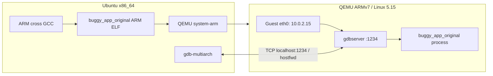

# LAB 03 — Remote Debugging, Memory Analysis, Profiling & Real-Time Latency

**LOS201 · Ubuntu 24.04 Host · Linux 5.15 ARMv7/QEMU Target · GDB · Valgrind · strace · perf · cyclictest**

[← Workspace](../README.md) · [← LAB 02](../embedded_lab2/README.md)

> **Kết quả thực nghiệm của nhóm:** GDB xác định 3 lỗi; Valgrind giảm `definitely lost` từ **16.900 bytes xuống 0**; `perf record` (workload 3.000 vòng) ghi **4.446 samples, 0 lost**; `cyclictest` max latency **50 µs baseline / 299 µs stress**. Đây là phép đo thực, **không sao chép số liệu** từ repo tham khảo.

## Mục lục

- [1. Mục tiêu và phạm vi](#1-mục-tiêu-và-phạm-vi)
- [2. Môi trường Host–Target](#2-môi-trường-hosttarget)
- [3. Project structure](#3-project-structure)
- [4. Part A — Remote Debugging ARM](#4-part-a--remote-debugging-arm)
- [5. Part B — Memory Analysis](#5-part-b--memory-analysis)
- [6. Part C — Performance Profiling](#6-part-c--performance-profiling)
- [7. Part D — Real-Time Latency](#7-part-d--real-time-latency)
- [8. Năm câu hỏi phân tích](#8-năm-câu-hỏi-phân-tích)
- [9. Log, screenshots, báo cáo và checklist](#9-log-screenshots-báo-cáo-và-checklist)
- [10. Troubleshooting và giới hạn](#10-troubleshooting-và-giới-hạn)

## 1. Mục tiêu và phạm vi

LAB 03 sử dụng bộ công cụ Linux để debug, phân tích memory/performance và đo scheduling latency:

| Part | Công cụ | Nơi chạy | Mục tiêu |
|---|---|---|---|
| A | `gdb-multiarch` / ARM `gdbserver` | Host ↔ QEMU ARM | Breakpoint, biến, register, backtrace, ba lỗi C |
| B | Valgrind Memcheck | Host x86_64 | Phát hiện/khắc phục memory leak |
| B | `/proc/<PID>/status` | QEMU ARM | Quan sát VmRSS/VmSize trước/sau sửa |
| C | `strace`, `perf stat`, `perf record`/`report` | Host x86_64 | Syscall, counters, CPU hotspots |
| D | `cyclictest` + `stress-ng`, Gnuplot | Host Ubuntu | Wake-up latency với baseline và stress |

**Cần phân biệt:** Dữ liệu thời gian từ QEMU chịu chi phối mô phỏng; không sử dụng chúng làm benchmark chắc chắn cho hardware ARM. Đo `cyclictest` trên Host cũng không tự đại diện cho PREEMPT_RT hoặc deadline của một hệ thống robot hoàn chỉnh.

## 2. Môi trường Host–Target

| Mục | Giá trị |
|---|---|
| Host | Ubuntu 24.04 Noble, x86_64; lần đo trên kernel `6.8.0-147-generic` |
| Host preemption | PREEMPT_DYNAMIC / generic; **chưa** đo PREEMPT_RT |
| Guest | QEMU `vexpress-a9`, ARMv7 Cortex-A9, Linux 5.15, RAM 512 MiB / 2 vCPU |
| Guest filesystem | BusyBox initramfs kế thừa LAB 01, bổ sung ARM apps và gdbserver |
| Cross compiler | `arm-linux-gnueabihf-gcc` |
| Remote debug | Host `gdb-multiarch` ↔ TCP 127.0.0.1:1234 ↔ QEMU SLIRP hostfwd ↔ Guest gdbserver |
| Native analysis | Valgrind, strace, Linux perf, rt-tests, stress-ng, Gnuplot |

### Luồng remote debugging của nhóm



Khác bản tham khảo sử dụng UART–TCP, máy nhóm **đã kết nối thành công bằng QEMU user networking + `hostfwd`**. Đây là một cách triển khai remote GDB hợp lệ; không cần thay sang UART chỉ để khớp mẫu.

### Quy ước terminal

```text
HOST  $       cd ~/LOS201/embedded_lab3; qemu-system-arm; perf; valgrind
GUEST / #     ip ...; /usr/bin/gdbserver; cat /proc/PID/status
GDB   (gdb)   target remote; break; continue; backtrace; info registers
```

## 3. Project structure

```text
embedded_lab3/
├── README.md
├── apps/
│   ├── buggy_app_original.c           # 3 lỗi có chủ ý
│   ├── buggy_app_original             # bản ARM dùng GDB; xác minh bằng file
│   ├── buggy_app_fixed.c              # code đã sửa lỗi
│   ├── leaky_app.c / leaky_app         # bản x86_64 có memory leak
│   ├── leaky_app_fixed.c / leaky_app_fixed
│   ├── leaky_app_measure.c            # giữ process sống 30 s để quan sát /proc
│   ├── leaky_app_measure_arm
│   ├── leaky_app_fixed_measure.c
│   ├── leaky_app_fixed_measure_arm
│   ├── perf_target.c / perf_target    # 50 iterations
│   ├── perf_target_profile.c          # 3000 iterations, workload chuyên profiling
│   └── perf_target_profile
├── rootfs/
│   ├── initramfs_gdb/
│   └── initramfs_gdb_fixed/            # bản thêm fixed measurement
├── output/
│   ├── initramfs_lab3.cpio.gz
│   ├── initramfs_lab3_gdb.cpio.gz
│   └── initramfs_lab3_fixed_measure.cpio.gz
└── logs/
    ├── gdb_session.txt / gdb_original_bugs.txt
    ├── valgrind_report.txt / valgrind_fixed.txt
    ├── strace_summary.txt / strace_full.txt
    ├── perf_stat.txt / perf_report.txt
    ├── perf_profile.data / perf_profile_report.txt
    ├── hist_standard.txt / hist_stress.txt
    ├── stress_test.txt
    ├── latency_histogram_comparison.gnuplot
    ├── latency_histogram_comparison.png
    ├── vmrss_before_after.csv
    └── vmrss_before_after.png
```

Đây là các file đã được liệt kê trong quá trình thực hành và bổ sung sau đó. Không nên xóa bản original/broken: chúng là đầu vào có chủ đích của bài debug. Nếu ảnh PNG/sources trong bản clone khác vị trí, điều chỉnh link theo `find` chứ không tự nhận là có file.

## 4. Part A — Remote Debugging ARM

### 4.1. Ba lỗi cần xác định

| Bug | Vị trí logic | Quan sát | Sửa đúng |
|---|---|---|---|
| Array out-of-bounds | `for (i = 0; i <= len; i++)` | `i=5, len=5`, phần tử hợp lệ là `data[0]`…`data[4]` | Dùng `i < len`, kiểm tra input |
| Use-after-free | `free(buf); return buf;` | Trả con trỏ đã hết lifetime, dữ liệu có thể bị ghi đè | Không `free` trước return; caller giải phóng sau khi sử dụng |
| Signed integer overflow | `int result = a * b;` | `100000 * 100000` quan sát int `1410065408` thay vì giá trị toán học `10000000000` | `(long long)a * b`, in `%lld` |

**Lưu ý:** Signed overflow là **undefined behavior** theo C; `1410065408` là kết quả quan sát ở phiên chạy, không phải giá trị bắt buộc trên mọi compiler/optimization. Một bản source gốc của nhóm còn gọi `free(msg)` với con trỏ được trả về sau `free(buf)`, có nguy cơ **double-free** bổ sung.

### 4.2. Build ARM ELF có debug symbols

**HOST `$`:**

```bash
cd ~/LOS201/embedded_lab3
arm-linux-gnueabihf-gcc -g -O0 \
  -march=armv7-a -mfpu=neon-vfpv3 -mfloat-abi=hard \
  -o apps/buggy_app_original apps/buggy_app_original.c

file apps/buggy_app_original
readelf -h apps/buggy_app_original | grep -E 'Class:|Machine:'
```

Phải có `ELF 32-bit ARM`, debug symbols. Nếu app phụ thuộc shared libraries, target rootfs cần đúng ARM loader/libraries; có thể xem `readelf -l ... | grep interpreter`.

### 4.3. Boot QEMU System ARM với TCP port forwarding

Một lần thành công dùng kernel + DTB **từ LAB 01**, initramfs LAB 03 có gdbserver:

```bash
cd ~/LOS201/embedded_lab3
# Dùng đường dẫn kernel LAB 01 đã có trong các phiên debug của nhóm:
ls -lh "$HOME/embedded_lab1/output/zImage" \
       "$HOME/embedded_lab1/output/vexpress-v2p-ca9.dtb" \
       output/initramfs_lab3_gdb.cpio.gz

qemu-system-arm -M vexpress-a9 -m 512M -smp 2 \
  -kernel "$HOME/embedded_lab1/output/zImage" \
  -dtb "$HOME/embedded_lab1/output/vexpress-v2p-ca9.dtb" \
  -initrd output/initramfs_lab3_gdb.cpio.gz \
  -append 'console=ttyAMA0,115200 rdinit=/sbin/init mem=512M' \
  -net nic -net user,hostfwd=tcp:127.0.0.1:1234-:1234 \
  -nographic -no-reboot
```

Nếu Lab 1 nằm ở `~/LOS201/embedded_lab1`, **thay hai đường dẫn** bằng vị trí đúng. Không boot đồng thời hai QEMU với cùng host TCP port 1234. `-net user` là SLIRP networking phía QEMU, không tự thay cho việc gán IP Guest trong tình huống script DHCP thiếu.

### 4.4. Cấu hình network trong Guest

**GUEST `/ #`:**

```sh
ip link set eth0 up
udhcpc -i eth0 -n -q
ip -4 addr show dev eth0
ip route
```

Phiên đã thử: DHCP cấp lease `10.0.2.15`, nhưng **script DHCP không gán địa chỉ vào interface**, nên cần thiết lập thủ công nếu `ip -4 addr` chưa có `10.0.2.15/24`:

```sh
ip addr add 10.0.2.15/24 dev eth0
ip route add default via 10.0.2.2 dev eth0
ip -4 addr show eth0
```

Nếu đã có IP/route thì **không thêm trùng**. Kiểm tra mạng thực tế thay vì mặc định đây là IP cố định cho mọi QEMU configuration.

### 4.5. Chạy gdbserver trong Guest

```sh
ls -l /usr/bin/gdbserver /usr/bin/buggy_app_original
/usr/bin/gdbserver 0.0.0.0:1234 /usr/bin/buggy_app_original
```

Đã xác minh `Listening on port 1234`. **Không dùng `gdbserver :1234`** với bản gdbserver trong initramfs đã kiểm tra: cú pháp đó từng báo lỗi phân giải tên; dùng `0.0.0.0:1234`.

Nếu binary gdbserver ARM đang dynamically linked, initramfs phải có `ld-linux-armhf.so.3` và các thư viện ARM tương ứng, **không** copy thư viện x86 của Host.

### 4.6. GDB trên Host

Mở terminal **Ubuntu mới**, không gõ các lệnh dưới đây trong QEMU:

```bash
cd ~/LOS201/embedded_lab3
gdb-multiarch ./apps/buggy_app_original
```

Tại **`(gdb)`**:

```gdb
set pagination off
set sysroot /usr/arm-linux-gnueabihf
target remote 127.0.0.1:1234
break main
continue
backtrace
info registers r0 r1 r2 r3 sp lr pc cpsr
list
```

Để quan sát lỗi cụ thể (đặt breakpoint theo tên hàm, dùng `list` xem dòng source của **bản thực tế**):

```gdb
break process_data
break create_message
break calculate
info breakpoints
continue
info locals
print i
print len
backtrace
```

`print i` chỉ hợp lệ khi GDB đang ở scope của biến `i`. Đừng paste tất cả lệnh GDB vào terminal Host `$`. GDB RSP cho phép quan sát trạng thái process ARM, backtrace và registers từ Host.

## 5. Part B — Memory Analysis

### 5.1. Valgrind Memcheck trên Host

**HOST `$`:**

```bash
cd ~/LOS201/embedded_lab3
# Nếu cần biên dịch lại bản native (x86_64)
gcc -g -O0 -o apps/leaky_app apps/leaky_app.c
gcc -g -O0 -o apps/leaky_app_fixed apps/leaky_app_fixed.c

valgrind --leak-check=full --show-leak-kinds=all \
  --track-origins=yes ./apps/leaky_app \
  > logs/leaky_run_before.txt 2> logs/valgrind_report.txt

valgrind --leak-check=full --show-leak-kinds=all \
  --track-origins=yes ./apps/leaky_app_fixed \
  > logs/leaky_run_after.txt 2> logs/valgrind_fixed.txt
```

Dòng thống kê có thể xem nhanh:

```bash
grep -E 'definitely lost:|in use at exit:|All heap blocks were freed|ERROR SUMMARY:' \
  logs/valgrind_report.txt logs/valgrind_fixed.txt
```

### 5.2. Kết quả quan sát (phiên đo đã lưu)

| Chỉ số | Before Fix | After Fix |
|---|---:|---:|
| Allocation count | 352 | 352 |
| Free count | 102 | 352 |
| Bytes in use at exit | 16.900 | 0 |
| Definitely lost | **16.900 bytes / 250 blocks** | **0 bytes / 0 blocks** |
| Error summary | 3 contexts | 0 contexts |

Ba nhóm allocation bị mất:

| Nguồn | Bytes | Số blocks | Nguyên nhân |
|---|---:|---:|---|
| `create_record` → `r->scores` | 2.000 | 100 | Không `free(r->scores)` |
| `create_record` → `r->name` | 2.100 | 100 | Không `free(r->name)` |
| `process_messages` → `buf` | 12.800 | 50 | Không `free(buf)` trong vòng lặp |
| **Tổng** | **16.900** | **250** | Definitely lost |

Bản fixed giải phóng `r->name`, `r->scores`, `r`, message buffer và mảng `records` đúng vòng đời. Kết luận chỉ áp dụng với input/workload đã thử: Valgrind không chứng minh mọi code path tương lai đều không leak.

### 5.3. VmRSS/VmSize trên QEMU ARM

Hai source measurement có thêm `sleep(30)` để giữ process sống sau khi xử lý. ARM executables đã biên dịch dưới dạng static với flags dành cho ARMv7 hard-float:

```bash
arm-linux-gnueabihf-gcc -static -g -O0 \
  -march=armv7-a -mfpu=neon-vfpv3 -mfloat-abi=hard \
  -o apps/leaky_app_fixed_measure_arm apps/leaky_app_fixed_measure.c
```

Boot QEMU với `output/initramfs_lab3_fixed_measure.cpio.gz` (kiểm tra archive có app) rồi đo **GUEST `/ #`**:

```sh
/usr/bin/leaky_app_fixed_measure_arm &
PID=$!
for i in 1 2 3 4 5 6 7 8 9 10; do
  echo "===== Sample $i ====="
  [ -r /proc/$PID/status ] || break
  grep -E '^(VmSize|VmRSS):' /proc/$PID/status
  sleep 1
done
wait "$PID"
```

Áp dụng tương tự cho `leaky_app_measure_arm`, **chỉ nếu binary đó có trong initramfs**. Kết quả **sau pha xử lý, trong thời gian sleep(30)** của hai phiên bản:

| Metric | Before Fix | After Fix |
|---|---:|---:|
| Samples | 10 | 10 |
| VmSize | 624 kB | 624 kB |
| VmRSS | 4 kB | 4 kB |

**Diễn giải:** Hai lần quan sát đều `VmRSS=4 kB` **không bác bỏ** leak 16.900 bytes. VmRSS là số trang resident đang được kernel tính cho process, phụ thuộc paging, allocator, thời điểm và kernel; Memcheck mới theo dõi quan hệ `malloc/free`. Biểu đồ Before/After nằm chồng nhau tại 4 kB nên trong báo cáo nhóm có thể **chỉ dùng bảng và giải thích** thay vì chèn biểu đồ trùng đường.

## 6. Part C — Performance Profiling

### 6.1. Chương trình benchmark

`apps/perf_target.c` dùng `ARRAY_SIZE=100000`, `ITERATIONS=50`, chạy `heavy_compute` với `sqrt(x)*log(x+1)`, `linear_search` và ghi file bằng stdio. Bản `apps/perf_target_profile.c` được tạo **riêng** với `ITERATIONS=3000` để thu đủ samples, **không sửa workload gốc**.

```bash
cd ~/LOS201/embedded_lab3
grep -nE 'ARRAY_SIZE|ITERATIONS' apps/perf_target_profile.c
gcc -g -O1 -fno-omit-frame-pointer \
  -o apps/perf_target_profile apps/perf_target_profile.c -lm
file apps/perf_target_profile
```

Đo profiling **Host x86_64**, không so sánh thời gian chạy bản Host với QEMU ARM như tốc độ hai loại CPU thực.

### 6.2. Phân tích syscall bằng strace

```bash
cd ~/LOS201/embedded_lab3
strace -c -o logs/strace_summary.txt ./apps/perf_target
strace -o logs/strace_full.txt ./apps/perf_target
cat logs/strace_summary.txt
```

Một phiên đo trước đó ghi nhận **124 syscalls**, tổng thời gian syscall khoảng **0,003427 s**, top theo *% time* là `write` 46,51%, `execve` 17,60%, `close` 12,58%, `munmap` 9,22%, `mmap` 6,62%. `strace` chỉ đo syscalls; `% time` không tương đương tỷ lệ tổng wall-clock thời gian ứng dụng.

`fprintf` 10.000 lần không nhất thiết tạo 10.000 syscall `write` do có **stdio buffering**.

### 6.3. Perf stat — hardware counters

```bash
cd ~/LOS201/embedded_lab3
sudo perf stat -e cycles,instructions,task-clock \
  -o logs/perf_stat.txt -- ./apps/perf_target
cat logs/perf_stat.txt
```

Một lần đo bản workload 50 iterations: khoảng 90,7 triệu cycles, 377,8 triệu instructions, IPC khoảng 4,16. Counter phụ thuộc CPU/PMU và quyền Host; giá trị mới khi chạy lại có thể khác.

### 6.4. Perf record/report — 3.000 iterations

**Đã gặp lỗi thực tế:** Ubuntu `perf_event_paranoid=4` chặn `perf record` khi chạy user thường; file `.data` 0 byte và `perf report` không đọc được. Phiên chạy thành công dùng `sudo perf record`:

```bash
cd ~/LOS201/embedded_lab3
sudo perf record -g -e cycles \
  -o logs/perf_profile.data -- ./apps/perf_target_profile \
  > logs/perf_profile_run.txt 2>&1

ls -lh logs/perf_profile.data
tail -12 logs/perf_profile_run.txt
```

**Dữ liệu đo thực tế:** `perf record` tạo file ~461 KB, **4.446 samples**, không mất mẫu. Không có quy tắc số samples phải bằng 395 samples của repo gợi ý.

Trong môi trường hiện tại, `perf report` ban đầu báo:

```text
File logs/perf_profile.data not owned by current user or root (use -f to override)
```

Sau khi **kiểm tra file path và xác nhận `.data` chính mình vừa tạo**, dùng `-f` để cho phép report đọc file:

```bash
cd ~/LOS201/embedded_lab3
stat -c '%U:%G %s bytes %n' logs/perf_profile.data
readlink -f logs/perf_profile.data

perf report -f -i logs/perf_profile.data \
  --stdio --no-children --sort symbol,dso \
  > logs/perf_profile_report.txt

head -35 logs/perf_profile_report.txt
```

**Không** dùng `-f` với file perf không đáng tin cậy/tải từ bên ngoài. Nếu `perf record` bị hạn chế trên máy người đọc, xem hướng dẫn quyền Linux Perf; không tự hạ cấu hình bảo mật hệ thống nếu không cần.

### 6.5. CPU hotspots — kết quả đã ghi nhận

| Hạng | Symbol / location | Self overhead |
|---|---|---:|
| 1 | `heavy_compute` / `perf_target_profile` | **44,97%** |
| 2 | `__ieee754_log_fma` / `libm.so.6` | **44,05%** |
| 3 | `log@@GLIBC_2.29` / `libm.so.6` | 5,75% |
| 4 | `log@plt` / executable PLT | 4,87% |
| 5 | Chưa phân giải kernel symbol (self) | 0,03% |

`--no-children` giúp xem **Self overhead** thay vì gộp thời gian call graph. `log@plt` là trampoline liên kết động, không phải phép toán nặng riêng biệt. Các phần trăm là **tỷ lệ samples/cycles được quy về symbol**, không phải phần trăm wall-time tuyệt đối.

### 6.6. Hướng tối ưu cần benchmark thêm

- Tránh tính lại `sqrt(x)*log(x+1)` 3.000 lần nếu dữ liệu không đổi: tiền xử lý hoặc cache các kết quả.
- Kiểm tra khả năng compiler tối ưu vòng lặp, loop unrolling, vectorization.
- Dùng ARM NEON/approximation **chỉ khi** có phân tích sai số; ARMv7 NEON không cung cấp vector native double-precision `log/sqrt` như một số kiến trúc hiện đại.
- Chạy `perf` trước/sau thay đổi để so sánh; không cam kết một tỷ lệ speedup khi chưa benchmark.

## 7. Part D — Real-Time Latency

### 7.1. Ý nghĩa phép đo

`cyclictest` đo **độ trễ từ thời điểm thread được kỳ vọng đánh thức đến lúc thực sự được scheduler cho chạy**, tính bằng **µs**. Cần quan tâm Max latency, histogram tails và tải nền. Nó **không** cộng thời gian tính ứng dụng, truyền bus/I/O hoặc network response.

Thí nghiệm ghi 4 threads, ưu tiên realtime 80, khoảng cách wake-up thường 1000 µs, tối đa 10.000 vòng/thread. Host sử dụng kernel generic/PREEMPT_DYNAMIC, **không phải PREEMPT_RT**.

### 7.2. Cách đo baseline và stress

Ví dụ lệnh tương đương về tham số (lặp lại có thể cho số đo khác):

**Terminal HOST A — Baseline:**

```bash
cd ~/LOS201/embedded_lab3
sudo cyclictest -m -p 80 -t 4 -i 1000 -l 10000 -h 200 \
  > logs/hist_standard.txt
```

**Stress:** Khởi chạy stress-ng tại **Terminal HOST B**, trong khi Terminal A chạy cyclictest lần nữa:

```bash
stress-ng --cpu 2 --io 2 --vm 1 --timeout 40s \
  > ~/LOS201/embedded_lab3/logs/stress_test.txt 2>&1
```

**Terminal HOST A — Under stress (đang có tải):**

```bash
cd ~/LOS201/embedded_lab3
sudo cyclictest -m -p 80 -t 4 -i 1000 -l 10000 -h 200 \
  > logs/hist_stress.txt
```

Trong phiên thực hành ban đầu, stress-ng có 2 CPU workers, 2 I/O workers và 1 VM worker. Hai lệnh cần **chạy chồng thời gian** để stress thực sự tác động lên cyclictest; không chạy stress xong rồi mới chạy cyclictest. `sudo` và realtime priority có thể bị giới hạn bởi host/container.

### 7.3. Bảng Min/Avg/Max đo được

| Thread | Baseline Min | Baseline Avg | Baseline Max | Stress Min | Stress Avg | Stress Max |
|---:|---:|---:|---:|---:|---:|---:|
| 0 | 2 | 8 | 31 | 2 | 6 | 176 |
| 1 | 2 | 4 | 44 | 2 | 4 | 232 |
| 2 | 2 | 3 | 50 | 2 | 4 | 299 |
| 3 | 2 | 3 | 42 | 2 | 5 | 181 |

**Đơn vị toàn bảng: µs.**

- Baseline: 10.000 mẫu/thread, max lớn nhất **50 µs**, 0 histogram overflow.
- Under stress: `Total = [10000, 9999, 9999, 10000]`, tổng **39.998 mẫu được thống kê**; max lớn nhất **299 µs**.
- Histogram stress có **2 overflow**, ở thread 1 và 2. Cycle ghi trong log lần lượt `6420` và `5874`.
- Có thể khẳng định hai độ trễ vượt **giới hạn histogram 199 µs**, nhưng **không** kết luận đó là vị trí của giá trị Max và **không** coi overflow là vượt deadline 500 µs.
- Với ngưỡng đánh giá giả định **500 µs**, Max của hai phép đo đều dưới ngưỡng trong cửa sổ quan sát; không suy ra bảo đảm deadline mọi lúc.

### 7.4. Tại sao không vẽ histogram trực tiếp đến 5000 µs?

Các log `logs/hist_standard.txt` và `logs/hist_stress.txt` chỉ ghi bins **0–199 µs** (200 dòng dữ liệu). Hai overflow trên 199 µs không có bin chi tiết trong file; kéo dài trục X đến 5000 µs rồi vẽ điểm tại 232/299 µs sẽ là **dựng thêm dữ liệu** không có trong log.

Biểu đồ đúng cách: (1) zoom phân phối 0–80 µs, (2) trục X đầy đủ phần **đã lưu 0–199 µs** và dùng logscale Y. File đã tạo là `logs/latency_histogram_comparison.png`.

### 7.5. Script Gnuplot tái tạo biểu đồ

**HOST `$`**: nếu script chưa có, lưu nội dung sau vào `logs/latency_histogram_comparison.gnuplot`:

```gnuplot
set terminal pngcairo size 1600,1000 enhanced font "DejaVu Sans,12"
set output "logs/latency_histogram_comparison.png"
set multiplot layout 2,1 title \
    "LAB-03: Cyclictest Latency - Ubuntu Standard Kernel" \
    font "DejaVu Sans,17"

set grid
set key top right
set xlabel "Scheduling latency (microseconds)"
set ylabel "Number of samples"

# Column 1 = latency bin in us; columns 2..5 = counts from four threads.
set title "Latency Distribution: 0-80 us"
set xrange [0:80]
set yrange [0:*]
unset logscale y
plot \
  "logs/hist_standard.txt" using 1:($2+$3+$4+$5) \
    with lines linewidth 2 title "Baseline", \
  "logs/hist_stress.txt" using 1:($2+$3+$4+$5) \
    with lines linewidth 2 title "Under stress"

set title "Recorded Histogram: 0-199 us (2 stress overflows above range)"
set xrange [0:199]
set yrange [0.9:*]
set logscale y
plot \
  "logs/hist_standard.txt" using 1:($2+$3+$4+$5) \
    with points pointtype 7 pointsize 0.65 title "Baseline", \
  "logs/hist_stress.txt" using 1:($2+$3+$4+$5) \
    with points pointtype 5 pointsize 0.7 title "Under stress"
unset multiplot
```

Tạo PNG:

```bash
cd ~/LOS201/embedded_lab3
gnuplot logs/latency_histogram_comparison.gnuplot
xdg-open logs/latency_histogram_comparison.png
```

Muốn histogram bao quát cả `299 µs` và mốc deadline 500 µs, phải **chạy lại phép đo** với ví dụ `-h 1000`, ghi rõ đây là lần đo mới; không sửa file histogram gốc.

### 7.6. So sánh Standard / PREEMPT_RT

| Tiêu chí | Kernel Ubuntu generic/PREEMPT_DYNAMIC đã đo | PREEMPT_RT |
|---|---|---|
| Kết quả thực nghiệm | Có baseline/stress và histogram | **Chưa đo** |
| IRQ / critical sections | Có thể tạo latency spikes | Nhiều IRQ có thể chuyển thành threads; giảm non-preemptible regions |
| Priority inversion | Có thể xảy ra khi đồng bộ tài nguyên | `rtmutex` / priority inheritance trong nhiều paths |
| Kết luận | Max 50 → 299 µs ở hai lần đo | **Không** đưa ra số speedup hoặc Max giả định |

Nếu robot cần phản hồi dưới 500 µs, phải đo **end-to-end deadline** dưới tải đại diện và lặp lại nhiều lượt, kết hợp `ftrace/trace-cmd`, CPU affinity, IRQ analysis; kết quả cyclictest một lần chỉ đánh giá wake-up latency.

## 8. Năm câu hỏi phân tích

### Q1. Điều gì xảy ra khi gõ `next` ở remote GDB?

GDB trên Host nhận lệnh step-over, giao tiếp với `gdbserver` bằng **GDB Remote Serial Protocol (RSP)** qua TCP forwarding. Server điều khiển process ARM (ví dụ dùng ptrace/breakpoints phù hợp) rồi trả stop reply, registers/memory; GDB kết hợp debug symbols để hiện source. Giao thức này khác một lệnh shell trực tiếp trong QEMU.

### Q2. `definitely lost` khác `indirectly lost`?

`definitely lost`: khối cấp phát còn tại lúc kết thúc nhưng Valgrind không tìm được con trỏ hợp lệ tới đầu khối. `indirectly lost`: khối chỉ còn reachable qua một khối khác đã mất. Ở Lab này `Record` được free nhưng `name` và `scores` không free, message buffer cũng bị bỏ quên, cho tổng **16.900 bytes definitely lost**, 0 indirectly lost.

### Q3. Tối ưu CPU hotspot thế nào?

Giảm tính toán lặp không cần thiết, hoãn tính/tiền xử lý nếu mảng không đổi, thử compiler/vectorization/unrolling hoặc approximation có kiểm soát sai số. Dùng perf trước và sau tối ưu với cùng workload để so sánh; không tuyên bố speedup khi chưa benchmark.

### Q4. Nguồn scheduling latency spike là gì?

IRQ handlers kéo dài, sections giữ lock/tắt preemption, tranh chấp CPU hoặc memory/page faults có thể gây trì hoãn đánh thức RT thread. PREEMPT_RT giảm một số đường không preemptible bằng threaded IRQ và primitive đồng bộ ưu tiên cao, nhưng không loại bỏ hết mọi latency và chưa được kiểm thử trong project này.

### Q5. Chọn công cụ theo vấn đề?

| Triệu chứng | Công cụ ưu tiên |
|---|---|
| Crash ngẫu nhiên / biến sai / call stack bất thường | GDB, core dump; thêm Valgrind nếu nghi memory corruption |
| RAM tăng / không giải phóng allocation | Valgrind, `/proc/<PID>/status`, heap profiling |
| CPU chạy nóng, một hàm chậm | `perf record/report`, `perf stat` |
| Nghi syscall / I/O syscall quá nhiều | `strace -c` và syscall traces |
| Thỉnh thoảng bỏ lỡ deadline | `cyclictest`, ftrace/trace-cmd, tải nền đại diện |

## 9. Log, screenshots, báo cáo và checklist

### 9.1. Các file chứng cứ chính

| File | Ý nghĩa |
|---|---|
| `logs/gdb_original_bugs.txt` / `logs/gdb_session.txt` | Backtrace, locals, registers, ba bug |
| `logs/valgrind_report.txt` | 16.900 bytes definitely lost |
| `logs/valgrind_fixed.txt` | 0 leaks, 0 errors |
| `logs/vmrss_before_after.csv` | 10 mẫu VmRSS Before/After |
| `logs/strace_summary.txt` | Bảng syscall và thời gian |
| `logs/perf_stat.txt` | Counters của workload 50 iterations |
| `logs/perf_profile.data` | Raw sampling data của 3000 iterations |
| `logs/perf_profile_report.txt` | Self overhead, 4.446 samples |
| `logs/hist_standard.txt` / `logs/hist_stress.txt` | Histogram và min/avg/max |
| `logs/stress_test.txt` | Stress-ng workload |
| `logs/latency_histogram_comparison.png` | Hai panel baseline/stress, 0–80 / 0–199 µs |

> File `perf_profile.data` có thể lớn và được tạo dưới `sudo`. Trước khi chia sẻ public repo hãy cân nhắc dung lượng và thông tin kernel/process nằm trong perf traces. Nếu không commit binary data, vẫn giữ bản log textual/report để giảng viên kiểm chứng.

### 9.2. Lệnh xem nhanh toàn bộ kết quả

```bash
cd ~/LOS201/embedded_lab3

echo '== MEMORY =='
grep -E 'in use at exit:|definitely lost:|ERROR SUMMARY:' \
  logs/valgrind_report.txt logs/valgrind_fixed.txt

echo '== PERF =='
grep -m 3 -E 'Samples:|Total Lost Samples' logs/perf_profile_report.txt
grep -E '^[[:space:]]*[0-9]+[.,][0-9]+%' \
  logs/perf_profile_report.txt | head -8

echo '== CYCLICTEST =='
grep -E '^# (Total|Min Latencies|Avg Latencies|Max Latencies|Histogram Overflows)' \
  logs/hist_standard.txt logs/hist_stress.txt
```

### 9.3. Checklist

- [ ] Guest QEMU boot bằng kernel/DTB của Lab 1 và initramfs Lab 3.
- [ ] GDB remote kết nối, có breakpoint, backtrace, registers và quan sát đủ 3 bugs.
- [ ] Valgrind có trước/sau sửa với `definitely lost` và `ERROR SUMMARY`.
- [ ] VmRSS đo bằng `/proc/<PID>/status` được diễn giải đúng giới hạn.
- [ ] Có `strace -c`, `perf stat`, `perf record/report` và nêu **workload** của từng phép đo.
- [ ] Có `hist_standard`, `hist_stress`, histogram mới và phân biệt overflow với deadline.
- [ ] Nêu rõ chưa kiểm nghiệm PREEMPT_RT thật.
- [ ] Nộp kèm source, image, raw logs/PNG và báo cáo Word/PDF phù hợp yêu cầu giảng viên.

## 10. Troubleshooting và giới hạn

| Vấn đề | Hướng xử lý |
|---|---|
| GDB `Connection refused/timed out` | `gdbserver 0.0.0.0:1234`; Guest eth0/IP; hostfwd `127.0.0.1:1234-:1234`; QEMU cũ không chiếm port |
| DHCP trả lease nhưng Guest không có IP | `ip -4 addr show eth0`, gán IP/route thủ công **nếu thiếu** |
| ARM gdbserver không chạy | `file`, `readelf -l`, ARM dynamic loader + libraries trong initramfs |
| GDB breakpoint khác số dòng file | Dùng bản source và binary cùng build, `list`, `info source`, debug `-g -O0` |
| Valgrind báo leak nhưng VmRSS đứng yên | Công cụ đo thứ khác nhau; snapshot memory không thay thế allocation tracing |
| `perf_event_paranoid=4` | Thử `sudo perf record` theo chính sách hệ thống |
| `perf report` báo file owner | Chỉ với file do mình tạo và đã kiểm tra: `perf report -f` |
| `perf report` không có samples | Không đọc file 0 byte; tăng workload riêng rồi đo lại |
| Histogram có overflow | `-h 200` chỉ lưu bins 0–199; Max có thể >199; không tự tạo bin ngoài phạm vi |
| Stress max dưới 500 µs | Không chứng minh mọi lần chạy về sau đều thỏa hard deadline |
| `cyclictest` đo trên QEMU | Không dùng kết quả QEMU làm đo timing vật lý; bài này đo Host |

**Nguồn:** đề `LAB03_EmbeddedLinux.docx`, báo cáo nhóm 4 và raw logs/terminal thực nghiệm ngày 20–21/10/2026. README tham khảo bố cục từ [Lab03 README của myNameDyK](https://github.com/myNameDyK/embedded-linux-kernel-development/tree/main/Lab03); số liệu đã ghi theo máy của nhóm. Tài liệu bổ sung: [Valgrind Memcheck](https://valgrind.org/docs/manual/mc-manual.html), [Linux perf security](https://www.kernel.org/doc/html/latest/admin-guide/perf-security.html), [rt-tests/cyclictest](https://wiki.linuxfoundation.org/realtime/documentation/howto/tools/cyclictest/start).
